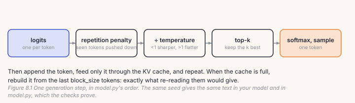
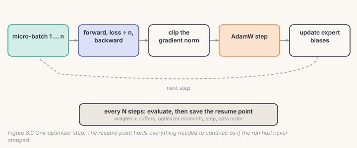
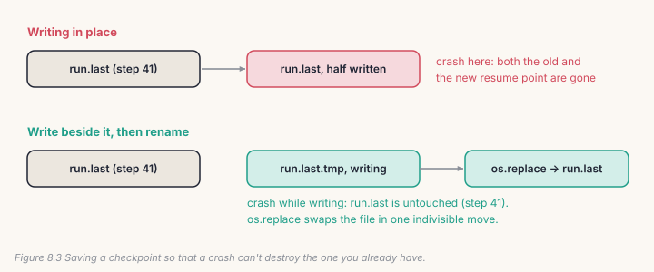
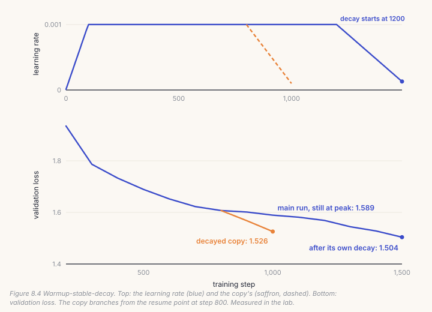
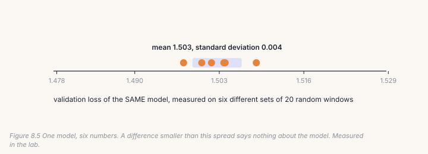

Your model is finished: Chapter 7 proved that its weights load into `model.py`
and give the same outputs. This chapter adds what turns a model into a
training run that survives for days: generating text from it, the learning-rate
schedule, the optimizer's settings, gradient accumulation, and checkpoints you
can resume from *exactly*. None of these bugs show up in a five-minute test.
Each one costs a long run, and every story in this chapter's notebook is one
that cost us.

## 8.1 Generating text

Chapter 6 gave you a minimal `generate`. The real one, `model.py`'s, adds four
controls, applied to the last position's logits in a fixed order:



```python
# build/solutions/ch08.py, MoELM.generate (identical to model.py's)
if repetition_penalty != 1.0:                        # tokens already used: less likely again
    seen = logits.gather(1, idx)
    seen = torch.where(seen > 0, seen / repetition_penalty, seen * repetition_penalty)
    logits = logits.scatter(1, idx, seen)
logits = logits / max(temperature, 1e-5)             # below 1 sharper, above 1 flatter
if top_k is not None:                                # only the k most likely survive
    v, _ = torch.topk(logits, min(top_k, logits.size(-1)))
    logits[logits < v[:, [-1]]] = -float("inf")
nxt = torch.multinomial(F.softmax(logits, dim=-1), num_samples=1)
```

The **repetition penalty** has a subtlety. A positive logit is *divided* by
the penalty, but a negative one is *multiplied*. Dividing a negative logit would
bring it closer to zero and make the token *more* likely. Two more details
matter in practice. With `eos_id`, a row that has finished keeps receiving the
end token, so a batch stays rectangular, and generation stops when every row is
done. And when the KV cache reaches `block_size`, it is rebuilt from the last
`block_size` tokens, which gives exactly what re-reading them would.

The check holds you to `model.py` token for token: same weights, same seed,
same text, including past the end of the context.

## 8.2 The learning-rate schedule

The learning rate is the size of each step. Every run warms it up from near
zero (the first steps' gradients are wild) and lowers it near the end (small
steps settle the model into a good spot). AnuLM's `train.py` offers two shapes:

- **cosine**: after warmup, the rate falls along half a cosine wave to a
  minimum at the last step;
- **warmup-stable-decay (WSD)**: after warmup, the rate stays *flat* at its
  peak, then falls in a straight line over the last part of the run.

```python
# build/solutions/ch08.py, lr_at (identical to train.py's)
if step < warmup:
    return lr * (step + 1) / max(warmup, 1)
if schedule == "wsd":
    decay_start = int(steps * (1 - decay_frac))
    if step < decay_start:
        return lr
    return lr + (min_lr - lr) * min((step - decay_start) / max(steps - decay_start, 1), 1.0)
progress = min((step - warmup) / max(steps - warmup, 1), 1.0)
return min_lr + 0.5 * (lr - min_lr) * (1 + math.cos(math.pi * progress))
```

WSD has a practical advantage, which the lab shows: while the rate is flat, you
can stop the run, extend it, or *decay a copy* at any point, without disturbing
the main run.

## 8.3 The optimizer

Every AnuLM run uses **AdamW** with three choices that matter:

```python
# build/solutions/ch08.py, make_optimizer (train.py's groups)
decay    = [p for p in model.parameters() if p.requires_grad and p.dim() >= 2]
no_decay = [p for p in model.parameters() if p.requires_grad and p.dim() < 2]
torch.optim.AdamW([{"params": decay, "weight_decay": 0.1},
                   {"params": no_decay, "weight_decay": 0.0}],
                  lr=lr, betas=(0.9, 0.95), eps=1e-8)
```

**Weight decay** gently shrinks weights towards zero every step, which keeps
them from growing without need. It belongs on the big matrices, never on the
RMSNorm gains: decaying those would drag every normalisation layer towards zero
for the whole run. **betas (0.9, 0.95)**, rather than PyTorch's default 0.999,
let the optimizer's running estimates adapt faster, which large-model training
has found more stable. And the experts' balancing bias is not here at all: it is
a buffer, not a parameter (Chapter 7).

`train.py` also offers **Muon**, which orthogonalises each matrix's update. In
our small-scale comparison (`docs/RESULTS.md` §32), batched Muon was the
largest single gain we found, −0.371 in loss at the same 25M tokens.

## 8.4 Gradient accumulation and the step

A big batch gives a cleaner gradient, but may not fit in memory. **Gradient
accumulation** splits it into micro-batches, adds up their gradients, and only
then takes one step. To get the *mean* loss's gradient, each micro-batch's loss
is divided by their number:

```python
# build/solutions/ch08.py
def accumulate(model, batches):
    model.zero_grad(set_to_none=True)
    for x, y in batches:
        _, loss = model(x, y)
        (loss / len(batches)).backward()          # each micro-batch's share of the mean

def train_step(model, opt, batches, lr, clip=1.0):
    ...
    loss = accumulate(model, batches)
    torch.nn.utils.clip_grad_norm_(model.parameters(), clip)    # no step larger than this
    opt.step()
    model.update_expert_biases()                  # after the step, never part of the loss
```



What if you forget the `/ len(batches)`? We measured it. With 4 micro-batches,
the gradient is 4× too large (norm 5.39 against 1.35). But after clipping and one
AdamW step, the weights differed by **0.000000015**, nothing at all. AdamW
divides each gradient by its own running size, and clipping caps the norm, so a
constant factor nearly disappears. The bug is real (it breaks plain SGD, the
logged loss, and any clipping threshold you tuned), yet checking the *weights*
would never find it. The check compares *gradients*.

## 8.5 Checkpoints you can resume from

A run that dies on day four must not start over. A resume point has to hold
**everything** that determines what happens next:

- the weights, **and the buffers**: the experts' balancing biases aren't
  parameters, but they are part of the model;
- the **optimizer's state**: AdamW's running averages, one pair per weight;
- the **step**, so the schedule continues where it was;
- the **data order**: the random generator's state, so the next batches are the
  ones the uninterrupted run would have seen.

And it must be written so that a crash *while saving* can't destroy it:



```python
# build/solutions/ch08.py, save_checkpoint
tmp = Path(str(path) + ".tmp")
torch.save({"model": model.state_dict(), "opt": opt.state_dict(), "step": step, **extra}, tmp)
os.replace(tmp, path)                             # one indivisible swap
```

## 8.6 Catch it

```bash
python course/checks/ch08.py              # your build/anulm.py
python course/checks/ch08.py --self-test  # proves the checks catch their bugs
```

| check | the silent bug it catches |
|---|---|
| `generate_matches_model` | top-k ignored; a penalty that divides negative logits; no cache rebuild |
| `generation_stops_at_eos_like_model` | finished rows not held at EOS |
| `lr_at_matches_train_py` | WSD decaying at the wrong point; warmup from 0; cosine to 0 |
| `weight_decay_spares_norms` | norms decayed; PyTorch's default betas |
| `accumulation_gives_large_batch_gradients` | accumulation without dividing |
| `train_step_updates_the_balancer` | the balancing bias never updated |
| `resume_is_exact` | optimizer state, or buffers, missing from the checkpoint |
| `a_crash_mid_save_keeps_the_old_checkpoint` | a checkpoint written in place |

The self-test runs fourteen broken versions; all fourteen are caught. On its
first run it caught a gap in our own checks: the only repetition-penalty test
also used top-k = 5, and tokens with negative logits almost never make the top 5,
so a penalty that divided them went unnoticed. A test with a strong penalty and
no top-k now covers it.

## Lab: a run with a resume point

1. Fill in the Chapter 8 section of `course/build/anulm.py`; run the checks
   until all 9 pass.
2. Pre-train Chapter 7's expert model with your machinery:

```bash
cd course/ch08-pretrain
python lab.py                      # yours; about five minutes on CPU
python lab.py --impl solution
python make_figures.py
```

The lab runs 1,500 steps of warmup-stable-decay, saving a resume point at step
800, then does three things with it.

**It crashes and resumes.** A fresh model, started from a different random
seed, loads the resume point and continues. At step 900 its validation loss is
1.6015, and so is the uninterrupted run's.

**It decays a copy.** From the same point, a second model lowers its learning
rate to the minimum over 200 steps, while the main run stays at its peak.



At step 1,000 the decayed copy reaches **1.526**; the main run, still at full
learning rate, is at 1.589. The main run gets to 1.504, but only after its own
decay at step 1,500. A decay is where much of a run's final improvement is
collected, and with WSD you can collect it early, on a copy, without stopping
the main run.

**It measures its own error bar.**



The same finished model, measured on six different sets of 20 random windows,
gives numbers spread over 0.011. Two runs that differ by less than that haven't
been shown to differ at all. Our own records found the same problem at scale
(`docs/RESULTS.md` §26): six window sets on one checkpoint spread over 0.36.
`train.py` now prints the error beside every validation loss, and can measure
on fixed, evenly spaced windows instead (`--eval-windows`).

It ends by writing:

```
ROMEO:
That was assistered.

DUKE VINCENTIO:
Come, that wonder of beauty, welcome, something,
```

## Code tour: the same pieces in `train.py` and `model.py`

- **`lr_at`** (`train.py`, line 248) is yours, plus `--rewarmup`, which ramps
  back up when an extended run would otherwise jump mid-cosine.
- **`make_optimizer`** (line 310) builds your groups, or Muon plus a companion
  AdamW. `OptimizerSet` (line 272) steps them together.
- **The step** (lines 684–712) is your `train_step`, plus bf16 autocast, an
  optional distillation term, and logging.
- **The resume point** (lines 614–675 and 734–740) holds everything yours does,
  plus the best validation loss and how it was measured. If the resume point
  can't be read, it falls back to the best checkpoint and says what was lost.
- **`atomic_save`** (line 32) is your save. **`AnuLM.generate`** (`model.py`,
  line 1059) is yours, plus an `on_token` hook that `api.py` uses to stream
  replies.

> **From the lab notebook**
> `atomic_save`'s docstring records why it exists. On 12 September 2026, at
> step 265,000 of the 400M coder run, the process was killed while writing its
> 4.8 GB resume point, and `torch.save` left a truncated file that `torch.load`
> refused, and the run lost its optimizer state. (The resume code can fall
> back to the separate best checkpoint for the weights; nothing can bring back
> the optimizer's moments.) Since then every save goes beside the file and is renamed into
> place. A second lesson sits in the resume code itself: loading the 4.6 GB
> resume point straight onto an 8 GB GPU, and keeping it referenced, pushed the
> card into system memory and made training 20× slower. It is now loaded on the
> CPU and dropped as soon as it has been used.

## Try it on your own data

1. Generate from the lab's model with temperature 0.3, 0.8 and 1.5, with and
   without top-k 40. Describe what each does to the text.
2. Train with the cosine schedule instead of WSD for the same 1,500 steps.
   Which ends lower? Which would you rather have if you didn't know how long you
   could train?
3. Remove the optimizer from the checkpoint and resume. How big is the dent in
   the loss, and how many steps does it take to recover?
4. Measure the error bar of a validation loss with 5, 20 and 80 windows per set.
   How does the spread shrink as the windows grow?
5. *Open-ended:* run Muon on the lab model (`muon.py`, `--optimizer muon` in
   `train.py`) and compare with AdamW at equal steps and equal time.

## Key takeaways

- Generation applies a repetition penalty, temperature and top-k, in
  `model.py`'s order; your model now produces the same text from the same seed.
- Warmup, then decay: warmup-stable-decay keeps the rate flat so a copy can be
  decayed at any point. In the lab, a 200-step decay took a copy from 1.607 to
  1.526.
- Weight decay belongs on matrices, not on norms; AdamW uses betas
  (0.9, 0.95).
- Accumulation must divide by the number of micro-batches. AdamW and clipping
  hide the mistake, so check gradients, not weights.
- A resume point holds weights, buffers, optimizer state, step and data order,
  written beside the old one and renamed. Resuming from it gave an identical run.
