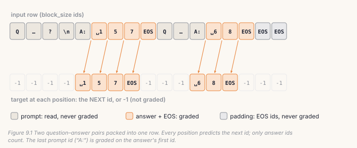
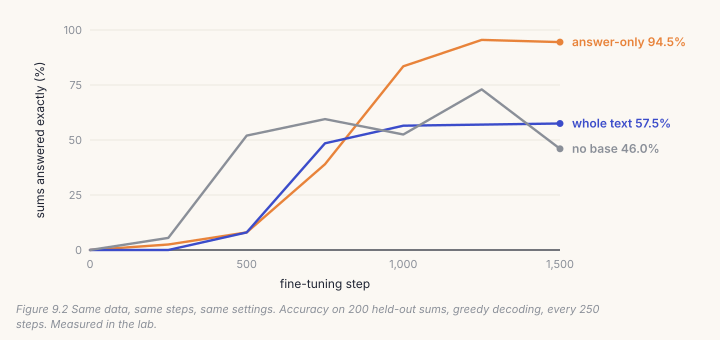
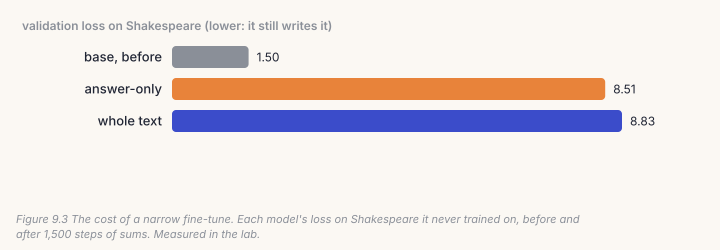

A pre-trained model continues text. Ask it a question and it writes whatever
would most likely follow those words: more questions, a story, an article.
Supervised fine-tuning (SFT) shows it many questions, each followed by an
answer, until answering is what follows. The code is short: format each pair,
pack the pairs into rows, and keep the loss off the question. Every bug in it
still trains, so you won't see one in the loss curve. The model just learns a
little less of what you meant.

This is Part III: the model from Part II, taught to do things. Your code goes
in a new file, `course/build/post.py`.

> **From the lab notebook**
> `docs/RESULTS.md` §20 fine-tuned the 364M Hindi model on 56,478 question–
> answer pairs that `make_qa.py` built from Wikipedia lead sentences. Asked
> about a held-out subject, the base model named that subject 12% of the time,
> and usually wandered into a story. After 1,702 steps (15 minutes) the
> fine-tuned model named it 81% of the time, and stopped after one or two
> sentences. But picking the right answer out of four only rose from 43% to 50%.
> Most of what SFT taught was the *format*. The facts had to come from
> pre-training.

## 9.1 One pair, as ids

`make_qa.py` has one template per language. The English one is:

```
Question: {q}
Answer:
```

The answer follows after one space, then the end-of-text id:

```python
# build/solutions/ch09.py, pair_ids (identical to finetune.py's _pair_ids)
return encode(template.format(q=question)), encode(" " + answer) + [eos]
```

Two details matter.

**The space goes with the answer.** A BPE tokenizer splits text into chunks
that start with their space (Chapter 3: `" the"` is one token). Written out in
full, "Answer: New Delhi" contains the token `" New"`, not `"New"`. Encode the
answer without its space, and every fine-tuning example starts the answer with
a token the model will never meet when it reads the prompt and answer as one
text, which is exactly how it will meet them when it is used.

**The answer ends with EOS.** The end token is the only thing that teaches the
model to *stop*. Leave it out and the model answers, then keeps going: another
question, another answer, until it hits the length limit.

## 9.2 Pack the pairs; grade only the answers

Pairs are short and rows are long, so several pairs share one row, which wastes
no compute on padding. Every position is still trained to predict the next id,
but the targets for the question's ids are set to −1, which the loss ignores
(`ignore_index=-1`, Chapter 4).



```python
# build/solutions/ch09.py, pack (identical to finetune.py's)
for p, a in pairs:
    ex = p + a
    if len(ex) > block_size:
        continue                                   # too long for any row: dropped, never cut
    if len(ids) + len(ex) > L:
        flush()                                    # doesn't fit: start a new row
        ids, lab = [], []
    ids = ids + ex
    lab = lab + [-1] * len(p) + list(a)            # the prompt is read, never graded
...
return x[:, :-1].contiguous(), y[:, 1:].contiguous()   # position t predicts id t + 1
```

Rows are `block_size + 1` ids long, so that the shift by one (`x` is the row
without its last id, `y` the labels without their first) leaves `block_size`
predictions per row. The last prompt position, the one reading "Answer:", is
graded on the answer's first id, because that is the prediction the model will
have to make when it is used.

A pair is never split across two rows. Its second half, alone at the start of
a row, would be an answer with no question, and the model would learn to
produce answers to questions it was never asked.

## 9.3 Catch it

```bash
python course/checks/ch09.py              # your build/post.py
python course/checks/ch09.py --self-test  # proves the checks catch their bugs
```

| check | the silent bug it catches |
|---|---|
| `pair_ids_match_finetune` | the answer encoded without its leading space |
| `the_answer_ends_with_eos` | no end token: a model that never stops |
| `pack_matches_finetune` | any difference from `finetune.pack`, at three row sizes |
| `loss_lands_on_answers_only` | the prompt left in the loss |
| `targets_are_the_next_id` | labels not shifted by one |
| `examples_are_never_cut` | pairs cut across rows, or long ones truncated |

The checks run against the repository's own `finetune.py` with a real BPE
tokenizer, so the space before the answer is tested where it actually changes
the ids. The self-test plants five bugs; all five are caught.

## Lab: teach the Shakespeare model to add

Chapter 8's model has read only Shakespeare. The lab teaches it something it
has never seen: two-digit sums, asked in English.

```
Question: what is 83 plus 74?
Answer: 157
```

```bash
cd course/ch09-sft
python lab.py                      # yours; about twelve minutes on CPU
python lab.py --impl solution
python make_figures.py
```

Four runs on 6,000 training sums, 1,500 steps each, batch 16, learning rate
3 × 10⁻⁴. Every 250 steps each model answers 200 sums it has never seen,
greedily, and only an exact answer counts.

- **answer-only**: from Chapter 8's model, loss on the answer only;
- **whole text**: from the same model, loss on every id, the question included;
- **no base**: answer-only, but from random weights;
- **with replay**: answer-only from Chapter 8's model, and every step also
  trains on a batch of Shakespeare.



**Grading only the answer wins clearly: 94.5% against 57.5%.** The whole-text
run spends most of its gradient on the question. "Question: what is" is easy
to predict, but the two numbers that follow are random, and no amount of
training makes them predictable. The loss on them stays high, and their
gradients are noise that the answer has to compete with. `finetune.py` masks
the prompt for exactly this reason. In §20, the answers were 73% of positions;
in the lab they are only 11%, so the difference here is large.

**Pre-training helped, even on a task with no Shakespeare in it.** From random
weights, the model learned some sums, then lost them again: 52% at step 500,
73% at step 1,250, and 46% at the end. The pre-trained model climbed steadily
and stayed up. What it brought was not arithmetic. It already knew how bytes
form words, digits and lines, so fine-tuning only had to teach the sums.



**But the fine-tuned model forgot Shakespeare.** Its loss on Shakespeare went
from 1.50 to 8.51, which is worse than guessing every byte uniformly
(ln 259 = 5.56). Fifteen hundred steps of nothing but sums taught it, with
confidence, that every text is a sum. This is called *catastrophic
forgetting*, and the answer-only run is no exception: a full fine-tune on a
narrow task moves every weight towards that task.

**Replay is the fix.** Each step of the replay run also trains on a batch of
Shakespeare, so it does twice the work and gives the sums only half of each
gradient. The sums lost nothing for it: **96.0%** right, and Shakespeare's loss
ended at 1.53 instead of 1.50. The replay run even learned the sums faster
(95.5% by step 1,000, against 83.5%), probably because the Shakespeare batches
kept the model from drifting far from the base. This is why AnuLM's one model
(Chapter 14) trains every task in one mix, and why chat keeps a share of the
steps even though the starting model could already chat.

## Code tour: the same pieces in `finetune.py`

- **`_pair_ids`** (line 53) is your `pair_ids`. It chooses the template by
  the pair's `lang`: `make_qa.PROMPTS` has Hindi, English, Python, both
  translation directions, and reading from retrieved passages (Chapter 12).
- **`pack`** (line 84) is yours, built in flat `int32` arrays instead of lists,
  because a few million pairs as Python lists of ints would need tens of
  gigabytes. `load_packed` (line 114) caches the packed rows next to the data,
  so a second run starts training in seconds.
- **The loop** (lines 302–347) is Chapter 8's step on the packed rows: AdamW,
  a cosine schedule, clipping, and the experts' balancing biases updated after
  every step (line 317). It prints the share of positions that are answers
  (line 263), so you know how much of the batch is graded.
- **The checkpoint** it keeps is the best one on held-out answers, and it
  carries its templates (`qa_templates`), so `serve.py` and the evaluation
  scripts know how to ask it.

> **From the lab notebook**
> The §20 model answered, but greedy decoding sometimes looped: two of six
> printed answers repeated one phrase until the length limit. Fine-tuning had
> not caused this, and more fine-tuning didn't fix it. The fix was in
> generation: `generate()` gained the repetition penalty (Chapter 8), and
> `serve.py`'s question mode uses 1.3. That broke the loops without changing
> the answers that were already fine.

## Try it on your own data

1. Change the lab's template to one of your own, for example `"Q: {q} A:"`.
   Does accuracy change? How quickly does the model learn the new format?
2. Remove the EOS from `pair_ids` (with the checks off) and generate 40 bytes
   after a question. What does the model write after the answer?
3. Run replay with a quarter of each step instead of half (a Shakespeare batch
   of 4 rows). Where does the trade between sums and Shakespeare land?
4. `make_qa.py` turns articles in the corpus format (a title, a blank line, the text) into
   question–answer pairs. Point `--data` at articles of your own, and
   fine-tune the lab's model on the pairs.
5. *Open-ended:* the lab's sums are all two-digit. Test the answer-only model
   on three-digit sums. What does it get right, and what does that tell you
   about what it learned?

## Key takeaways

- SFT teaches a format more than facts. In §20, naming the subject rose from
  12% to 81%, while recognising the right answer rose only from 43% to 50%.
- The answer is encoded with its leading space and ends with EOS. Pairs share
  rows but never cross them.
- Grade only the answer. In the lab: 94.5% against 57.5% for the same steps.
- A full fine-tune on a narrow task forgets the rest: Shakespeare loss 1.50 →
  8.51. Mixing the old data back in kept it at 1.53, with 96.0% of the sums right.
