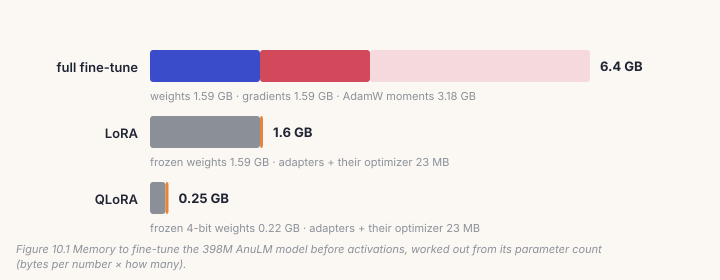
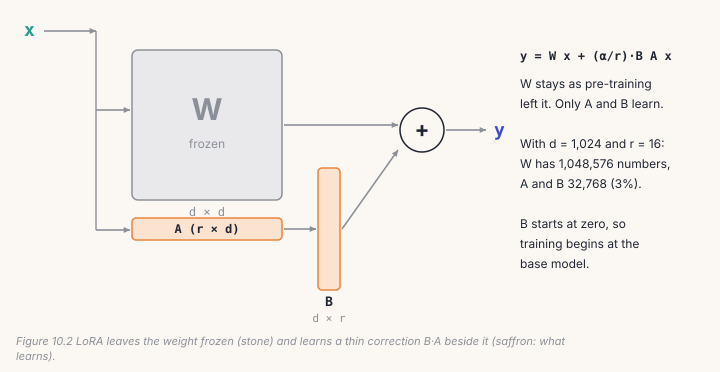
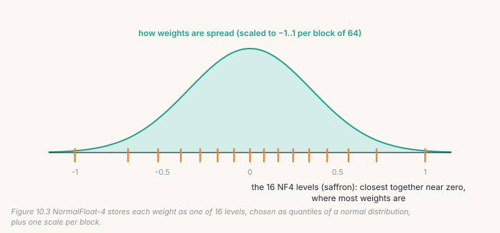
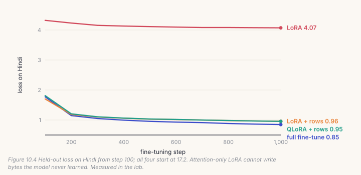
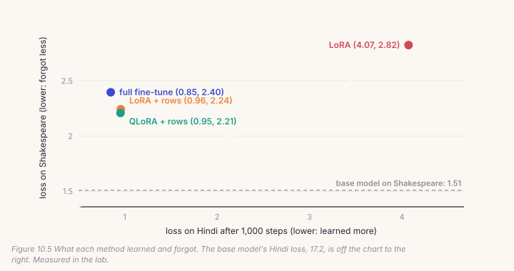

Chapter 9 changed every weight of the model. This chapter changes almost
none of them. *LoRA* freezes the model and trains a thin correction beside a
few of its layers. *QLoRA* does the same with the frozen weights squeezed into
4 bits. You will write both in `course/build/post.py`, on the expert model you
built in Part II, and teach it a language it has never seen, Hindi. Along the
way you will hit two problems that tutorials on dense models never show: a
language whose bytes the model never learned, and expert biases that keep
moving while everything else is frozen.

## 10.1 Why not just fine-tune everything?

A full fine-tune keeps training every weight, exactly as pre-training did.
It is the simplest option and usually the best one. Its problem is memory.
For every weight, the GPU must hold the weight itself, its *gradient* (which
way it should move), and two running averages that the AdamW optimizer
keeps: 4 + 4 + 8 = 16 bytes per weight, before counting the text being
processed.



For the 398M AnuLM model that is 6.4 GB, which fits a 16 GB gaming card. For
a 7-billion-parameter model it is 112 GB, which fits no consumer GPU at all.
LoRA and QLoRA exist to close that gap.

## 10.2 LoRA: a thin correction beside a frozen weight

**LoRA** (*low-rank adaptation*) freezes the original weight matrix *W* and
trains a small correction beside it. The correction is not a full matrix
the size of *W*. It is the product of two thin ones, *B* and *A*:



The number *r*, the **rank**, sets how thin they are. Your layer is
`lora.py`'s, name for name, so the checks can load one into the other:

```python
# build/solutions/ch10.py, LoRALinear (identical to lora.py's)
def __init__(self, base, r=16, alpha=32.0):
    self.base = base                                        # frozen: requires_grad False
    self.scale = alpha / r
    self.lora_a = nn.Parameter(torch.empty(r, base.in_features))
    self.lora_b = nn.Parameter(torch.zeros(base.out_features, r))   # zero: start as the base
    nn.init.kaiming_uniform_(self.lora_a, a=math.sqrt(5))

def forward(self, x):
    return self.base(x) + ((x @ self.lora_a.t()) @ self.lora_b.t()) * self.scale
```

Three details matter more than they look.

- **B starts at zero.** At step 0 the correction is exactly nothing, so
  the model starts as the base model and can't begin worse than it. (*A*
  can't also be zero, or neither would ever get a gradient.)
- **The scale is alpha / r.** Doubling the rank doubles the number of terms
  in the correction; dividing by *r* keeps its size, and so the right learning
  rate, about the same.
- **Only A and B get gradients and optimizer state.** That is where the
  memory saving comes from: the 16 bytes per weight from §10.1 now apply only
  to the adapter's numbers.

`apply_lora` freezes every parameter in the model, then wraps each `Linear`
whose name ends with a target. `lora.py`'s default targets are the attention
projections, `attn.query_key_value` and `attn.dense`. On your Chapter 8 model
that is 8 layers, and at *r* = 16, **40,960 trainable numbers, 4% of the
model**. On the 398M model it is 0.4%.

After training, `merge_lora` folds each correction into its weight,
*W* + (alpha / r) · *B A*, and puts the plain `Linear` back. The merged model
is an ordinary checkpoint, and it costs nothing extra to run. In the lab,
merging changed no logit by more than 0.00003.

## 10.3 QLoRA: keep the frozen part in 4 bits

LoRA still keeps the frozen weights in full 32-bit precision, which is the
largest item on the memory bill. **QLoRA** notices that frozen weights only
have to be *read*, never updated, and stores them in 4 bits: one-eighth of
the memory.

Four bits allow only 16 different values. The trick is choosing *which* 16.
Trained weights are spread like a bell curve, crowded near zero, so QLoRA's
**NormalFloat-4** (NF4) format puts its 16 levels where the weights are:



Weights are handled in blocks of 64. Each block is divided by its largest
absolute value, so it fits between −1 and 1. Each weight is then replaced by
the code of its nearest level, and two 4-bit codes are packed into each byte:

```python
# build/solutions/ch10.py
def nf4_quantize(w):
    flat = w.detach().float().reshape(-1, BLOCK)
    absmax = flat.abs().max(dim=1, keepdim=True).values.clamp_min(1e-12)   # one scale per block
    codes = torch.bucketize(flat / absmax, (NF4[1:] + NF4[:-1]) / 2).to(torch.uint8).reshape(-1)
    return (codes[0::2] << 4) | codes[1::2], absmax.squeeze(1)              # two codes per byte

def nf4_dequantize(packed, absmax, shape):
    codes = torch.stack([packed >> 4, packed & 15], dim=1).reshape(-1).long()
    return (NF4[codes].reshape(-1, BLOCK) * absmax[:, None]).reshape(shape)
```

`bucketize` against the *midpoints* between levels gives each weight its
*nearest* level. An `NF4Linear` keeps only the packed codes and the scales, as
buffers, with no parameters at all, and rebuilds an approximate weight in
every forward pass. `apply_lora(..., quantize=True)` wraps it in a
`LoRALinear` exactly as before. Gradients flow *through* the rebuilt weight
into the adapters.

How much does squeezing cost? In the lab, storing the attention weights in
NF4 moved the model's Shakespeare loss from **1.509 to 1.512**.

> **Note**
> The repository has no QLoRA: `lora.py`'s docstring explains that at 398M,
> 4-bit storage would save about 1.2 GB, which wasn't worth a dependency on
> `bitsandbytes`. This chapter's NF4 is new code. Production QLoRA adds
> *double quantization*, which compresses the per-block scales too, and
> *paged optimizers*, which spill optimizer state to CPU memory during spikes.

## 10.4 Adapters on a mixture of experts: what you have to keep

LoRA's promise is that the frozen model doesn't change, so the adapters are
all you need to keep. On your model that promise is broken, and nothing warns
you.

Chapter 7's experts are chosen with a balancing bias, and Chapter 8's
`train_step` nudges those biases after every step. They are buffers, not
parameters, so freezing the parameters doesn't freeze them. During LoRA
training, the biases follow the new data's load, exactly as they did in
pre-training.

So the lab rebuilds its LoRA model twice, starting from a fresh copy of the
base each time:

| rebuilt from | tensors | routing choices that changed | largest logit gap | Hindi loss |
|---|---|---|---|---|
| adapters only | 16 | **55.7%** | 1.78 | 4.0751 |
| adapters + expert biases | 19 | 0% | 0 | 4.0721 (the trained model's) |

Measured in the lab: 1,024 Hindi bytes through the three expert layers, 3,072
choices of experts.

Without the biases, more than half of the choices land on different experts, and
logits move by up to 1.78. The loss barely changes (4.0751 against 4.0721),
which is why nobody notices. But the model you'd ship is not the model you
measured. The three extra tensors are 24 numbers here, and `adapter_state`
saves them with the adapters. `lora.py` does the same: its
`router_state_dict` (line 121) explains why in its docstring, and
`finetune.py --lora` saves it beside the adapters.

## 10.5 Catch it

```bash
python course/checks/ch10.py              # your build/post.py
python course/checks/ch10.py --self-test  # proves the checks catch their bugs
```

| check | the silent bug it catches |
|---|---|
| `lora_linear_matches_lora_py` | the scale upside down (r / alpha) |
| `a_new_adapter_is_the_base_model` | B initialised randomly: step 0 is already a different model |
| `only_the_adapters_train` | base weights left trainable |
| `merging_is_exact` | a merge that forgets the scale |
| `the_adapter_carries_the_router` | adapters saved without the expert biases |
| `nf4_round_trip_stays_within_half_a_level` | one scale for the whole tensor; rounding down; codes unpacked in the wrong order |
| `qlora_starts_as_the_4bit_base` | `quantize=True` ignored |

The self-test plants nine bugs; all nine are caught. Its first run showed that
one scale for a whole tensor passed the round-trip check, because the error
bound grows with the scale, so the bug loosened its own test. The check now
also requires each block of 64 to have its own scale.

## Lab: teach the Shakespeare model Hindi

```bash
cd course/ch10-lora-qlora
python lab.py                          # needs Chapter 8's base.pt; about five minutes on CPU
python lab.py --impl solution
python lab.py --data my_language.txt   # any text of your own
python make_figures.py
```

Four runs from Chapter 8's model, 1,000 steps each on Hindi Wikipedia text,
batch 16, 128 bytes:

- **full**: every weight trains, learning rate 3 × 10⁻⁴;
- **lora**: adapters on attention, `lora.py`'s default, at 2 × 10⁻³;
- **lora + rows**: the same adapters, and the embedding and output tables
  train too, at 5 × 10⁻⁴;
- **qlora + rows**: lora + rows, with the attention weights stored in NF4.

Before tuning, the model's loss on Hindi is **17.17**, far worse than a
blind guess (ln 259 = 5.56). It has never read a Devanagari byte, and it is
confidently expecting English.



**LoRA, as `lora.py` sets it up, barely learns Hindi: 4.07, against 0.85 for
the full fine-tune.** UTF-8 writes Devanagari with byte values that English
text never uses: **119 of the 184 byte values in the Hindi text never occur in
Shakespeare.** Their rows in the embedding table and the output head were
never trained. Adapters on attention can change how the model mixes what it
reads, but they can't give it a way to *write* bytes whose output rows are
still random. Let those two tables train too (another 66,304 numbers), and
LoRA learns Hindi almost as well as the full fine-tune: **0.96**.

This never came up on the real model. AnuLM's tokenizer and pre-training
included Hindi from the start, so every Hindi token had a trained row. The
same wall stands in front of anyone who adds new tokens to a model (Chapter 13
adds audio codes), and the fix is the same: the new rows must train.



| | trains | frozen weights in memory | you keep | Hindi | Shakespeare |
|---|---|---|---|---|---|
| base model | – | – | – | 17.166 | 1.509 |
| full fine-tune | 1,029,248 (100%) | – | 4.1 MB | **0.848** | 2.397 |
| LoRA | 40,960 (4.0%) | 4.2 MB | 0.16 MB | 4.072 | 2.824 |
| LoRA + rows | 107,264 (10.4%) | 3.9 MB | 0.43 MB | 0.957 | 2.244 |
| QLoRA + rows | 107,264 (10.4%) | **3.2 MB** | 0.43 MB | 0.955 | **2.209** |

Losses in nats per byte, lower is better, measured in the lab.

Three more things stand out.

1. **QLoRA learns as well as LoRA** (0.955 against 0.957). Its frozen
   weights take 3.2 MB instead of 3.9 MB here, because only the attention is
   stored in 4 bits and in this model most of the weight is in the experts.
2. **LoRA + rows forgot less than the full fine-tune** (2.24 against 2.40),
   with a tenth of the trainable numbers. Every method forgot a lot of
   Shakespeare, though: it trained on nothing else (Chapter 9's replay is the
   fix).
3. **Plain LoRA forgot the most** (2.82). Two probes, not in the lab, show
   where that came from. It was not the expert biases: putting the base's
   biases back changed Shakespeare's loss from 2.824 to 2.830. It was the
   learning rate: at 5 × 10⁻⁴, plain LoRA forgot much less (2.42) and learned
   just as little Hindi (4.12). With the rows trainable and 2 × 10⁻³, Hindi
   reached 0.90, but Shakespeare rose to 2.74. LoRA's usual higher learning
   rate costs memory of the old text.

So "LoRA learns less and forgets less" held here only once the adapters
could reach the layers the new language needs, at a gentle learning rate.
It is a tendency, not a law. Measure it on your own data.

## Code tour: the same pieces in `lora.py`

- **`LoRALinear`** (`lora.py`, line 50) is yours, plus optional dropout on the
  adapter's input. **`apply_lora`** (line 84) is yours, plus a refusal: the
  grouped expert kernel stacks the experts' weights directly and can't see
  through an adapter, so asking for expert adapters under `--moe-impl
  grouped` is an error with an explanation, not an `AttributeError` from
  inside the kernel.
- **`lora_state_dict`** and **`router_state_dict`** (lines 116 and 121) are
  your `adapter_state`, split in two. `finetune.py --lora` (line 213) trains
  with them and saves both (line 340).
- **`merge_lora`** (line 143) is yours. `python -m anulm lora merge` (line 171)
  rebuilds the base, loads the adapters, restores the expert biases, merges,
  and writes an ordinary checkpoint that every script in the repository can
  load.
- **`decide.py`** has its own adapter targets (line 125): `qv`, `attn`,
  `dense` (every linear except the output head and the routed experts), and
  `all` (the experts too).

> **From the lab notebook**
> On the real 398M model, LoRA lost to a full fine-tune on quality *and* on
> time (`docs/RESULTS.md` §29). Same 17,143 Hindi question–answer pairs, same
> base: the full fine-tune cut held-out loss by 0.512 in 131 seconds; the best
> LoRA run, rank 64 for three epochs, by 0.334 in 189 seconds.
>
> LoRA's win was elsewhere. For BANKING77's 77 intents (`logs/post_v2`), eight
> adapter recipes were tried. Adapting every layer, experts included,
> reached 90.2%, as good as a full fine-tune's 90.3%, but answered in 259 ms,
> because adapters on experts force the slow path. Recipe F, rank 64 on the
> `dense` layers, reached 89.0% in 56 ms, and shipped: one chat model, plus a
> small adapter per task, switched on per request (Chapter 12).

## Try it on your own data

1. Change the rank: `--rank 4` and `--rank 64`, with the rows trainable. How
   much does Hindi loss improve per extra adapter number? Where does it stop
   paying?
2. Train only the rows of byte values that never occur in Shakespeare (zero
   the other rows' gradients with a hook). Does LoRA still learn Hindi? Does it
   forget less?
3. Put adapters on the experts too (`targets` ending in `gate_proj`,
   `up_proj`, `down_proj`). What does it buy over attention, and at what cost?
4. Measure the NF4 error layer by layer: compare `nf4_dequantize` with the
   original weights. Which layers lose the most, and does it matter for the
   loss?
5. *Open-ended:* why can't you merge an adapter into 4-bit weights without
   losing something? Merge the QLoRA run into full-precision weights and
   compare its loss with the unmerged model's.

## Key takeaways

- A full fine-tune needs about 16 bytes per weight; that, not compute, is
  what stops it on a consumer GPU.
- LoRA freezes the weights and trains a thin product B·A beside each one;
  B starts at zero, so training starts from the base model. Merged, it costs
  nothing to run.
- QLoRA stores the frozen weights in 4-bit NF4, one scale per block of 64, and
  learned as well as LoRA here.
- Adapters on attention can't teach a model to write tokens whose rows never
  trained: Hindi loss 4.07, against 0.96 with the rows trainable.
- On a mixture of experts, the expert biases move during LoRA training.
  Keep them with the adapters, or you ship a different model: 55.7% of the
  expert choices changed.
