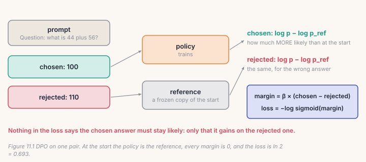
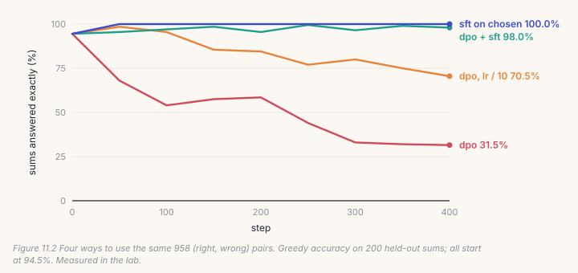
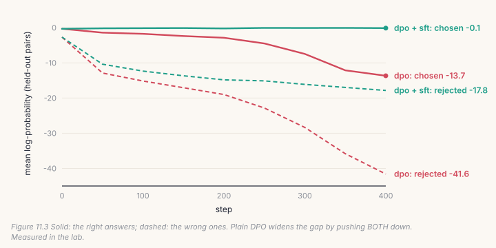

Supervised fine-tuning shows the model a good answer. It never shows it a bad
one. Preference tuning trains on *pairs* of answers to the same prompt, one
preferred (*chosen*) and one not (*rejected*), and teaches the model to tell
them apart. **DPO**, Direct Preference Optimization (Rafailov et al., 2023),
is the simplest way to do it: no reward model, no sampling during training,
just one loss on log-probabilities.

DPO is new code: AnuLM's models were never preference-tuned, so there is no
`dpo.py` in the repository to match. This chapter's lab is the first DPO run
on this project. It didn't go the way the tutorials suggest, and the checks
and the measurements show why.

## 11.1 Where preference pairs come from

A pair needs a prompt and two answers, one better than the other. People can
rate answers, a stronger model can, or a program can, when correctness can be
checked. The lab uses the last kind, because it needs nothing outside your
machine. Chapter 9's model answers every training sum four times, sampling at
temperature 1, and a line of Python checks each answer:

```
Question: what is 44 plus 56?
Answer: 100      chosen
Answer: 110      rejected
```

Out of 24,000 sampled answers, 90.9% were right. 1,058 of the 6,000 questions
got at least one right and one wrong answer, and each of those gives a pair.
These are the questions the model is unsure about, which is where a pair
can teach it something.

## 11.2 The log-probability of an answer

Everything DPO needs is one number per answer: the log-probability the
model gives it, the sum over its ids of log p(id | everything before it). It
has to count the answer's ids, and only those:

```python
# build/solutions/ch11.py, answer_logprobs
mask[i, len(p) - 1: len(p) - 1 + len(a)] = 1.0       # position t predicts id t + 1
logits, _ = model(ids[:, :-1])
logp = F.log_softmax(logits.float(), dim=-1).gather(-1, ids[:, 1:, None]).squeeze(-1)
return (logp * mask).sum(-1)
```

It is Chapter 9's mask again: the prediction of the answer's first id is made
at the prompt's last position. Pairs in a batch have different lengths, so
rows are padded on the right. The model is causal, so padding after an answer
can't change the positions before it, and the mask never counts it.

## 11.3 The loss

DPO compares two models: the **policy**, which trains, and the
**reference**, a frozen copy of where the policy started. For each answer it
asks how much more likely the policy makes it than the reference did:



```python
# build/solutions/ch11.py, dpo_loss
margin = beta * ((pol_chosen - ref_chosen.detach()) - (pol_rejected - ref_rejected.detach()))
return -F.logsigmoid(margin).mean(), margin.detach()
```

At the first step the policy *is* the reference, every margin is 0, and the
loss is −log sigmoid(0) = ln 2 = 0.693. The gradient isn't zero, though: it
pushes the chosen answer up and the rejected one down from the first step.
`beta` sets how strongly the margin counts: a small beta needs a large change
in log-probabilities before the loss is satisfied.

`dpo_step` puts it together: the reference's log-probabilities under
`torch.no_grad()`, the policy's with gradients, the loss, clipping, the
optimizer step, and then, because this is your expert model, the balancer
(Chapter 8). It also takes an `sft_weight`, which the lab will show you need.

## 11.4 Catch it

```bash
python course/checks/ch11.py              # your build/post.py
python course/checks/ch11.py --self-test  # proves the checks catch their bugs
```

| check | the silent bug it catches |
|---|---|
| `answer_logprobs_counts_the_answer_only` | the prompt counted; positions off by one; a mean per id instead of the sum |
| `padding_changes_nothing` | padding counted; left padding, which moves every position |
| `loss_is_ln2_when_policy_is_the_reference` | sigmoid instead of log-sigmoid; a wrong gradient at the start |
| `dpo_loss_matches_the_formula` | beta ignored |
| `the_reference_gets_no_gradient` | the reference not detached |
| `a_few_steps_prefer_the_chosen_answer` | chosen and rejected swapped |
| `the_step_moves_the_balancer` | the experts' biases never updated |
| `the_sft_term_is_the_chosen_answers_mean_loss` | the SFT term with the wrong sign, the wrong average, or ignored |

The self-test plants thirteen bugs; all thirteen are caught. The swapped
pair is the nastiest. Swapping makes the model prefer its *mistakes*, and the
DPO loss still falls just as smoothly. Only a measurement made outside the
loss, with the reference, can tell.

## Lab: preference-tune the sums model

```bash
cd course/ch11-dpo
python lab.py                      # needs Chapter 9's sft.pt; about three minutes on CPU
python lab.py --impl solution
python make_figures.py
```

Starting from Chapter 9's model (94.5% of held-out sums right, greedily), four
runs use the same 958 pairs (100 more are held out) for 400 steps of batch 16:

- **dpo**: plain DPO, learning rate 5 × 10⁻⁵, beta 0.1;
- **dpo, lr / 10**: the same at 5 × 10⁻⁶;
- **dpo + sft**: DPO plus the chosen answers' ordinary fine-tuning loss
  (`sft_weight=1`);
- **sft on chosen**: Chapter 9's fine-tuning, on the chosen answers only.



**Plain DPO wrecked the model: 94.5% → 31.5%.** Its loss fell the whole
time. It did what the loss asked: it made each chosen answer more likely
*relative to* its rejected one. Figure 11.3 shows how.



On held-out pairs, the rejected answers' log-probability fell from −2.7 to
−41.6, and the chosen answers' fell too, from −0.31 to −13.7. A right answer
at log-probability −13.7 is one the model almost never says. The margin was
huge, and the model had stopped answering correctly. This failure, where
both answers fall, was reported in several papers in 2024, and it is easy to
reproduce: when chosen and rejected answers share most of their ids (here,
"1" and "0" in "100" and "110"), pushing one down drags the other down with
it.

**A smaller learning rate only delays it.** At a tenth of the rate, DPO first
*helped*: 98.5% at step 50. Then it slid back to 70.5% while the loss kept
falling. If you watched only the loss, you would have kept training.

**Adding the SFT term fixed it: 98.0%.** With `sft_weight=1`, the loss also
pays for any drop in the chosen answers' probability, so they stayed near
−0.1 while the rejected ones fell to −17.9.

**But plain fine-tuning on the chosen answers did best: 100%** greedy, and
99.9% of samples at temperature 1. Here, every chosen answer is simply
*correct*, so there is nothing a preference adds that the right answer alone
doesn't teach. DPO is for preferences that you can't write down as a target:
which of two summaries is clearer, which reply is kinder. When a program can
check the answer, sample, keep what's right, and fine-tune on it.

## Code tour: where this would go in the repository

There is no `dpo.py` to tour. If you add one, it is `finetune.py` with a
different step:

- pairs instead of `_pair_ids`, each answer encoded the same way (a leading
  space, EOS at the end);
- a second, frozen copy of the starting checkpoint as the reference. On the
  398M model it doubles the weights in memory, but it needs no gradients or
  optimizer state;
- `answer_logprobs` for chosen and rejected in one padded batch, then
  `dpo_loss`, then everything `finetune.py` already does: clipping, the
  cosine schedule, `update_expert_biases`, and a held-out measurement that is
  *not* the loss: accuracy, or the chosen answers' log-probability.
- With LoRA (Chapter 10), the reference is free: it is the same model with
  the adapters switched off.

## Try it on your own data

1. Plot the DPO loss for the plain run beside its accuracy. When did the loss
   stop being a useful guide?
2. Try beta = 0.5 and beta = 0.02 with plain DPO. Which way does the collapse
   move, and why?
3. Make harder pairs: chosen = the right answer, rejected = the right answer
   plus or minus one. Does DPO now teach anything SFT doesn't?
4. Build pairs where both answers are right but one is shorter ("100" against
   "one hundred"). Teach the model your preference with DPO + SFT.
5. *Open-ended:* make the reference the model with LoRA adapters switched off
   (Chapter 10), and train only the adapters with DPO. How much memory does the
   frozen copy save?

## Key takeaways

- DPO trains on (chosen, rejected) pairs with one loss on log-probabilities,
  against a frozen reference; at the start it is exactly ln 2.
- The DPO loss rewards a gap, not a good answer. In the lab, plain DPO took
  accuracy from 94.5% to 31.5% while its loss fell.
- Watch something other than the loss: accuracy, or the chosen answers'
  log-probability.
- Adding the chosen answers' fine-tuning loss kept them likely: 98.0%.
- When a program can check the answer, fine-tuning on the right answers alone
  was simpler and better: 100%. Use DPO for preferences you can't check.
