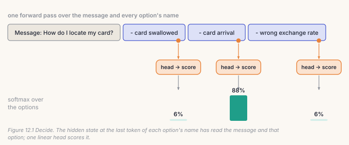
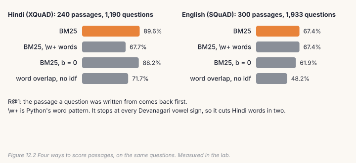
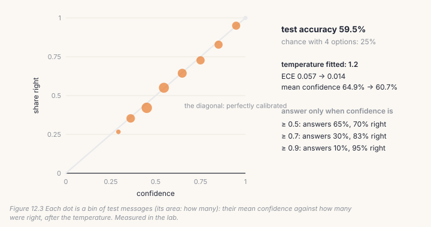

Not every job wants prose. Software often needs a *decision*: which queue a
message goes to, which intent it is, whether to answer or hand it to a person.
And a small model can't remember many facts, but it can read them if
something finds the right page first. This chapter builds both, the way
AnuLM does: **Decide**, which scores a list of options in one pass and says
how sure it is, and **BM25**, the search behind `rag.py`.

## 12.1 Decide: one pass, a probability for every option

`decide.py` puts the message and every option's name in one sequence, then
reads the model's hidden state at the **last token of each option's name**.
Because the model is causal, that position has read the message and that
option. A one-number linear head scores each of those states, and a softmax
over the scores gives a probability for every option.



```python
# build/solutions/ch12.py, encode_options (identical to decide.py's encode)
ids = [bos] + encode(f"Message: {text.strip()}\nWhich of these does it ask for?\nOptions:")
pos = []
for o in options:
    ids += encode(f"\n- {readable(o)}")          # 'card_arrival' -> 'card arrival'
    pos.append(len(ids) - 1)                     # where this option's score is read
```

```python
# build/solutions/ch12.py, Decider.forward
h = final_hidden(self.model, idx)                                   # (B, S, hidden)
g = h.gather(1, pos[..., None].expand(-1, -1, h.shape[-1]))         # one state per option
logits = self.head(g).squeeze(-1).float()
return logits if mask is None else logits.masked_fill(~mask, float("-inf"))
```

Three details matter. The answer can only be one of the options, never a
misspelling or an invention. The options are shuffled for every training
example, so the head learns to read names, not positions, and the same model
takes any list. And when examples in a batch have different numbers of
options, the missing ones are set to −∞, so they get probability 0.

## 12.2 Calibration: 0.9 should mean right nine times in ten

A probability is only useful if it means what it says. **Calibration**
compares confidence with accuracy: of all the answers given with confidence
around 0.9, about 90% should be right. The standard summary is the
*expected calibration error* (ECE): sort answers into bins by confidence and
add up, weighted by each bin's size, how far each bin's confidence is from its
accuracy.

Models trained with cross-entropy are usually overconfident. The fix
(Guo et al., 2017) is one number, a **temperature** *T*: divide every logit by
*T* before the softmax. *T* > 1 softens the probabilities, and it never changes
which option wins. `fit_temperature` tries *T* = 0.30, 0.35, …, 5.00 on
held-out messages and keeps the one with the lowest cross-entropy.

With calibrated confidence, Decide can choose when to answer. Set a threshold
and hand everything below it to a person: you trade *coverage* for
*accuracy*, and you know the rate in advance.

## 12.3 Lookup: BM25

Retrieval-augmented generation (RAG) finds passages that might hold the
answer, then has the model read them. `rag.py`'s finder is **BM25**, the
classic scoring function of search engines, written from scratch. For each
query word, each passage scores

idf × tf × (k₁ + 1) / (tf + k₁ × (1 − b + b × length / average length))

- **tf** is how often the word appears in the passage. Its effect *saturates*:
  the tenth "India" counts for less than the first. k₁ = 1.2 sets how fast.
- **idf** = log(1 + (N − df + 0.5) / (df + 0.5)) is high for words in few
  passages and near zero for words in all of them, so "the" counts for
  almost nothing. (Without the 1 +, it goes *negative* for very common words.)
- **b** = 0.75 normalises for length: a long passage contains more words by
  chance, so each match counts for a little less.

Each *distinct* query word counts once. And the words have to be the right
words:

```python
# build/solutions/ch12.py (identical to rag.py's)
WORD = re.compile(r"[0-9A-Za-zÀ-ɏऀ-ॿ]+")      # Devanagari vowel signs are word characters
```

Python's `\w` matches letters and digits, but not the Devanagari vowel signs
(*matras*), which Unicode classes as marks. `re.findall(r"\w+", "राजधानी")`
returns `['र', 'जध', 'न']`: three fragments, none of them a word.

## 12.4 Catch it

```bash
python course/checks/ch12.py              # your build/post.py
python course/checks/ch12.py --self-test  # proves the checks catch their bugs
```

| check | the silent bug it catches |
|---|---|
| `options_are_encoded_like_decide` | the score read at each option's first token |
| `each_score_is_read_at_its_option` | every option scored at the end of the sequence |
| `missing_options_get_no_probability` | padded options not masked |
| `temperature_matches_decide` | the temperature fitted on probabilities instead of logits |
| `calibration_matches_decide` | ECE bins not weighted by size; a Brier score on the top option only |
| `a_calibrated_model_has_small_ece` | the same, on a model calibrated by construction |
| `hindi_words_stay_whole` | `\w+` splitting Hindi; words not lower-cased |
| `bm25_scores_match_rag` | idf without log1p; no length normalisation; a repeated word counted twice; raw term frequency |
| `search_returns_the_best_first` | passages with score 0 returned |

The BM25 check runs `rag.py`'s own index-building arithmetic on six passages
and compares scores. The self-test plants thirteen bugs; all thirteen are
caught. One planned bug turned out not to be one: encoding the options as one
joined string instead of piece by piece gives the same ids with this
tokenizer, because `bpe.py` never merges across a line break, so the check
couldn't catch it and the bug was dropped.

## Lab: look things up, then decide

```bash
cd course/ch12-decide-rag
python lab.py                      # needs Chapter 8's base.pt; about ten minutes on CPU
python lab.py --impl solution
python make_figures.py
```

**Part 1, lookup.** 240 Hindi Wikipedia passages with 1,190 questions written
about them (XQuAD), and 300 English ones with 1,933 questions (SQuAD), both
CC BY-SA 4.0, in `data/`. For each question: does the passage it was written
from come back first?



| R@1 (R@5) | Hindi | English |
|---|---|---|
| **BM25** | **89.6%** (97.4%) | **67.4%** (88.9%) |
| BM25 with `\w+` words | 67.7% (83.4%) | 67.4% (89.0%) |
| BM25, b = 0 | 88.2% (96.9%) | 61.9% (85.9%) |
| word overlap, no idf | 71.7% (86.4%) | 48.2% (74.4%) |

**One regular expression cost Hindi 22 points of R@1** and English nothing.
`\w+` cut every Hindi word with a vowel sign into fragments that match
fragments of unrelated words: "भारत की राजधानी" becomes भ, रत, क, र, जध, न.
It is a cousin of Chapter 2's bug, where `convert_parquet`'s ASCII-only word
pattern made its deduplication blind to Hindi. **idf is worth 19 points in English and
18 in Hindi**: without it, "the", "of" and "है" decide the ranking. Length
normalisation matters less here, because the passages are of similar length.

**Part 2, decisions.** BANKING77 (CC BY 4.0): customer messages and 77
intents. Each example offers four options, the right one and three others at
random. Chapter 8's model, with a Decide head, trains on 9,003 messages for
3,000 steps; 994 more are held out to fit the temperature. Messages are cut to
80 characters so every example fits the model's 256 bytes; 13 of the 3,080
test messages still don't, and are left out.



The model gets **59.5%** of 3,067 test messages right, against 25% by chance.
It learned slowly: near chance for 500 steps, then a steady climb that was
still going at step 3,000. A Shakespeare byte model has to learn from scratch
what "card arrival" has to do with "How do I locate my card?".

But it already knew how sure to be. Before the temperature, ECE was 0.057;
the fitted *T* = 1.2 brought it to **0.014**, and changed no answer. And the
coverage table works: answering only at confidence ≥ 0.9, it answers 9.8% of
messages and gets **95.0%** of those right, from a model that gets 59.5%
overall. That is the point of calibration. A weak model with honest confidence
can still be trusted with part of the work.

## Code tour: the same pieces in `decide.py` and `rag.py`

- **`encode`** (`decide.py`, line 88) is yours. It offers all 77 intents in
  one pass, about 400 tokens, which a byte model can't fit in 256.
- **`Decider`** (line 101) wraps three backbones: AnuLM as trained (causal,
  yours), AnuLM made bidirectional, and ModernBERT for comparison. Its
  `freeze` trains only the head, or the head plus LoRA adapters (Chapter 10).
- **`fit_temperature`** and **`metrics`** (lines 344 and 353) are yours.
- **`Decide.on`** (line 626) adds a trained head and adapters to a model
  that is already loaded, the chat model, so one copy of the weights serves
  chat and decisions.
- **`rag.py`** builds the index once (`build`, line 99) over 932,648
  passages, with each word hashed to one of 2²⁴ buckets, so 12 processes can
  tokenise with nothing to merge. Each posting's BM25 weight is computed at
  build time, so a query is a weighted count per query word (`bm25`, line
  259). `rc_pointer.py` is the reader: a head that points at the answer's
  start and end in the retrieved passages.

> **From the lab notebook**
> On BANKING77 with all 77 options, the 400M model's Decide reached 89.2%
> (`docs/RESULTS.md` §34). Raw, it was overconfident: ECE 7.58%, mean
> confidence 96.8%. One temperature, 2.70, cut ECE to 2.38%. At confidence
> ≥ 0.9 it answered 73.9% of messages at 97.7% accuracy. In Hindi (§38,
> MASSIVE's 60 intents), the same method on AnuLM reached 84.0%, against
> 67.5% for ModernBERT, a strong English encoder whose tokenizer cuts
> Devanagari into byte fragments.
>
> Retrieval was humbler (§33). Over 932,648 real Wikipedia passages,
> instead of the lab's 240, BM25 put a passage containing the answer first
> for 24.7% of Hindi MLQA questions. A larger collection means more passages
> that look right and aren't.

## Try it on your own data

1. Offer six options instead of four (shorten the messages to fit). How much
   does accuracy drop? Does calibration hold?
2. Train Decide without shuffling the options (always alphabetical). Then
   test with the options shuffled. What did the head learn?
3. Fit the temperature on the test set itself. How much does ECE improve, and
   why is that number worthless?
4. Index a text of your own: split it into ~100-word passages and write ten
   questions. Compare BM25 with word overlap.
5. *Open-ended:* combine them. Retrieve with BM25, then use Decide to choose
   which of the top five passages answers the question.

## Key takeaways

- Decide scores every option in one pass, at the last token of each option's
  name; the answer is always one of the options.
- One temperature, fitted on held-out data, calibrates without changing any
  answer: ECE 0.057 → 0.014 in the lab.
- Calibrated confidence lets a weak model do part of the work well: 59.5%
  overall, 95.0% on the 9.8% it was sure about.
- BM25 needs idf, saturation and the right definition of a word. Python's
  `\w+` cost Hindi retrieval 22 points.
