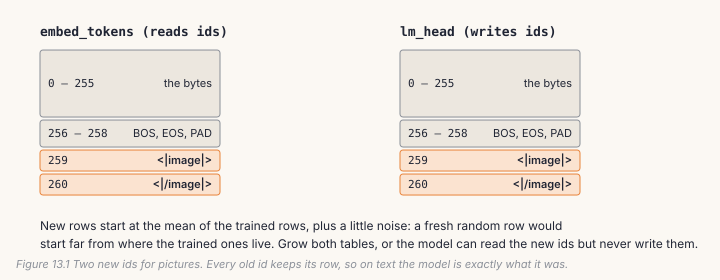
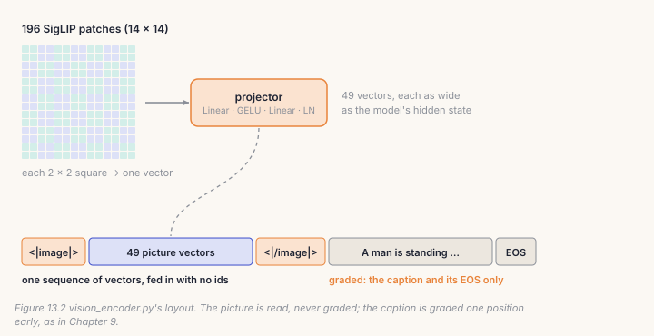
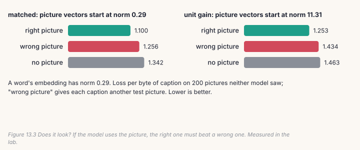

A language model reads ids. To hear or see, it needs a way in for sound and
pictures. AnuLM uses two. For speech it *writes*, it grows its vocabulary:
every audio code gets an id, and the model learns to emit them like any
other token. For pictures and speech it *reads*, a frozen encoder (SigLIP for
images, Whisper for audio) turns the input into vectors, a small **projector**
resizes them to the model's width, and they go in as embeddings with no ids at
all. This chapter builds both on your model and asks the question every
multimodal model should be asked: does it actually look?

## 13.1 New ids, new rows

`speech_vocab.py` appends 28,672 SNAC audio codes and five control tokens
(`<|speech|>`, `<|/speech|>`, `<|text|>`, `<|image|>`, `<|/image|>`) to the
vocabulary. Every id the model already had keeps its number and its row, so
on text the grown model is exactly the model that went in.



Two decisions matter.

**Grow both tables.** AnuLM's output head is not tied to its embeddings.
Grow only the embedding table and the model can *read* the new ids but never
write them; grow only the head and the reverse. Either fails as a shape
error minutes into training, or worse, doesn't fail at all.

**Start the new rows where the old ones live.** A fresh N(0, 0.02) row is
far from the trained rows, and the first few hundred steps would be spent
moving it there:

```python
# build/solutions/ch13.py, grow_rows (identical to speech_vocab._grow)
mean = weight.mean(dim=0, keepdim=True)
std = weight.std().item()
noise = torch.randn(n_new, weight.shape[1], generator=gen, dtype=weight.dtype) * (std * 0.1)
return torch.cat([weight, mean.expand(n_new, -1) + noise], dim=0)
```

The bill is real. On the 400M model, 28,677 new ids at width 1,024 add
29.4M parameters to each table: 15% more parameters, but 34% more *active*
ones, because embeddings are used by every token and the experts they join
are not (`speech_vocab.py`'s docstring).

## 13.2 Vectors in, with no ids

To feed pictures, the model needs a forward pass that starts from vectors.
Yours is the same pass without the lookup:

```python
# build/solutions/ch13.py, forward_embeds
x = embeds                                           # (B, S, hidden): no embed_tokens
cos, sin = model.rotary(x.shape[1], x.device, x.dtype)
for layer in model.layers:
    out = layer(x, cos, sin)
    x = out[0] if isinstance(out, tuple) else out    # an expert layer also returns its aux loss
logits = model.lm_head(model.norm(x))
```

Fed `model.embed_tokens(ids)`, it must give exactly what `model(ids)` gives,
and the checks hold it to that. Everything in this chapter goes through it.

## 13.3 The projector, and where the picture goes

SigLIP cuts a 224 × 224 picture into a 14 × 14 grid of patches and returns
one 768-number vector per patch: 196 vectors. `vision_encoder.py` pools each
2 × 2 square of neighbours into one vector of 4 × 768 numbers, then a small
network maps it to the model's width: Linear, GELU, Linear, LayerNorm.



The pooling has a trap. The 196 vectors arrive as a flat list, row by row.
Pooling four *consecutive* vectors would join the right edge of one row of
the picture with the left edge of the next. The squares have to be found in
2-D:

```python
# build/solutions/ch13.py, ImageProjector.forward (identical to vision_encoder.py's)
x = patches.reshape(g, g, D)                                    # back to a grid
x = x.reshape(gp, self.pool, gp, self.pool, D).permute(0, 2, 1, 3, 4)
patches = x.reshape(gp * gp, D * self.pool * self.pool)         # one vector per square
```

`build_caption` then lays out one sequence: `<|image|>`, the 49 projected
vectors, `<|/image|>`, and the caption. The targets are Chapter 9's: −1
everywhere except the caption's ids, each one position early. The picture is
read, never graded.

## 13.4 How loud is a picture?

A LayerNorm with its default gain of 1 outputs vectors with norm √width:
11.3 for your model's 128, 32 for the 400M model's 1,024. A text token's
embedding is much smaller: 0.29 here, 0.39 in AnuLM's chat model. So every
picture vector arrives some 40 to 80 times louder than a word.
`omni_train.py`'s `_match_scale` shrinks the projector's final LayerNorm,
gain and bias by one factor, so its output arrives at a word's size:

```python
# build/solutions/ch13.py, match_scale (identical to omni_train's _match_scale)
target = text_embeddings.float().norm(dim=-1).mean()
now = (ln.weight.float().pow(2).sum() + ln.bias.float().pow(2).sum()).sqrt()
ln.weight.mul_(target / now)
ln.bias.mul_(target / now)
```

For a normalised input *z*, the expected squared norm of *g* × *z* + *b* is
the sum of *g*² plus the sum of *b*², so one factor on both sets it. The
factor stays learnable, and it is saved in the checkpoint, so inference needs
nothing new.

## 13.5 Catch it

```bash
python course/checks/ch13.py              # your build/post.py
python course/checks/ch13.py --self-test  # proves the checks catch their bugs
```

| check | the silent bug it catches |
|---|---|
| `new_rows_match_speech_vocab` | new rows drawn from N(0, 0.02) |
| `growing_keeps_every_old_id` | only the embeddings grown: a model that can't write the new ids |
| `embeddings_in_give_the_same_model` | the final norm skipped; no positions for embedded inputs |
| `projector_matches_vision_encoder` | a flat stride; no LayerNorm |
| `pooling_joins_grid_neighbours` | squares that wrap from one row of the picture to the next |
| `captions_are_built_like_vision_encoder` | the picture graded; targets not shifted; no end-of-image marker |
| `projected_vectors_arrive_at_a_words_size` | the scale applied to the gain only; matched per number instead of per vector |

Each check runs the repository's own code beside yours: `speech_vocab._grow`,
`vision_encoder.ImageProjector`, `VisionLanguage.build`, and
`omni_train.Omni._match_scale`. The self-test plants eleven bugs; all eleven
are caught.

## Lab: give the Shakespeare model eyes

```bash
cd course/ch13-senses
python lab.py                      # needs Chapter 8's base.pt and the cached features; about eight minutes
python lab.py --impl solution
python make_figures.py
```

The pictures are Open Images photos with Localized Narratives captions
(CC BY 4.0). The repository has already run SigLIP over all 49,345 of them
and cached the patch vectors (`data/omni/caption_train.feats.f16`), so the lab
needs no vision model at all. It reads 2,000 pictures for training and 200
more that neither run sees. Your model grows two ids, `<|image|>` and
`<|/image|>`, and a projector (hidden width 256) learns with it. Two runs of
1,200 steps, batch 16:

- **matched**: the projector's output scaled to a word's size, 0.29;
- **unit gain**: LayerNorm's default, so picture vectors start at norm 11.3.

Then each run writes captions for 200 new pictures, and the lab measures the
caption loss three ways: with the right picture, with a different picture,
and with no picture.



**It looks.** With the right picture, the caption loss is 1.100 nats per byte;
with another picture it is 1.256, and with none, 1.342. If the model
ignored the picture, the right one and the wrong one would score the same.
Its captions are rough but grounded:

```
picture of:  Group of people are standing on the ground. These people are wearing uniforms and hats.
model wrote: This is a black and white image. In the middle of the image there are many people standing.

picture of:  An artillery tractor in the front, on the left side there is steering, ...
model wrote: A train on the road there are plants, there are some poles, there are some trucks on the ground.
```

**Matching the scale helped at every measurement.** The unit-gain run was
behind at every one of the six evaluations, ended at 1.253 against 1.100,
and wrote worse text ("A couple of compose drint poons in it is wearing
forwaors…").

Two things went wrong in both runs, and they are worth seeing:

- **Both overfitted.** Held-out caption loss was lowest at step 400 (0.894
  matched, 0.915 unit gain), then rose to 1.100 and 1.253: 1,200 steps of 16
  is almost ten passes over 2,000 pictures. In a real run you'd keep the best
  checkpoint, as every trainer in the repository does, and use more pictures.
- **Both forgot Shakespeare**: loss 1.50 → 3.70 matched, 3.81 unit gain.
  They trained on nothing else (Chapter 9: replay).

## Code tour: the same pieces in the repository

- **`speech_vocab.py`**: `_grow` (line 110) is your `grow_rows`;
  `grow_checkpoint` (line 119) grows both tables of a saved checkpoint, refuses
  a checkpoint whose size is neither the text vocabulary nor the grown one,
  and records the original size so a second pass knows where audio starts.
  `SpeechVocab` (line 71) is the map of where every kind of id lives.
- **`vision_encoder.py`**: `ImageProjector` (line 100) and
  `VisionLanguage.build` (line 144) are yours. `build_cache` (line 257) runs
  SigLIP once per picture and keeps the vectors on disk; that cache is what
  the lab reads.
- **`speech_encoder.py`** is the same design for audio: a frozen Whisper
  encoder, a projector, and audio vectors in front of the transcript.
- **`omni_train.py`**: `_match_scale` (line 197) is yours. `--proj-scale
  embed` applies it to both projectors when a joint run starts; the default,
  `ln`, leaves them at LayerNorm's scale.

> **From the lab notebook**
> `build_cache` exists because of one measurement. Before it, captioning
> trained at 6.9 seconds a step at batch 16, almost all of it decoding JPEGs
> and running the frozen tower, for a language-model step over 64 tokens.
> Flickr8k has five captions per picture, so the same pixels were encoded five
> times an epoch. The tower never changes, so its output never does either.
> At 196 × 768 half-precision numbers, a picture costs 301 kB, and caching all
> 49,345 Open Images pictures takes 14.9 GB of disk.
>
> And the scale: on the first AnuLM-Omni run, chat got much worse
> (Chapter 14), and the projectors' loud vectors were the first suspect.
> `_match_scale` was written for it. But an A/B at 3,000 batches gave chat
> 4.95 with matched projectors and 4.97 with the old ones: the scale was not
> the cause. It stayed an option (`--proj-scale embed`) rather than the
> default. On your model, the lab shows it helping the picture task itself;
> on the 400M model, that hasn't been measured.

## Try it on your own data

1. Train for 400 steps instead of 1,200. Is the right-versus-wrong gap
   larger or smaller at the best checkpoint?
2. Pool 1 × 1 (196 vectors per picture, `pool=1`). Does the model read more
   from the picture, and what does it cost in sequence length?
3. Freeze the model and train only the projector. How much of the gap
   survives?
4. Mix Shakespeare back in (Chapter 9's replay) and watch both losses.
5. *Open-ended:* write a caption check of your own. Give the model a picture
   and two captions, its own and another picture's. Which does it score
   higher, and how often?

## Key takeaways

- New kinds of output get new ids: grow both tables, and start the new rows
  near the old ones. On text, the grown model is unchanged.
- New kinds of input go in as vectors with no ids, through the same forward
  pass. A projector maps the encoder's vectors to the model's width; pool in
  2-D, not along the flat list.
- Picture vectors from a default LayerNorm are about 40 times louder than
  words here. Matching them to a word's size helped at every measurement.
- Ask whether the model looks: the right picture must beat a wrong one. Here,
  1.100 against 1.256.
