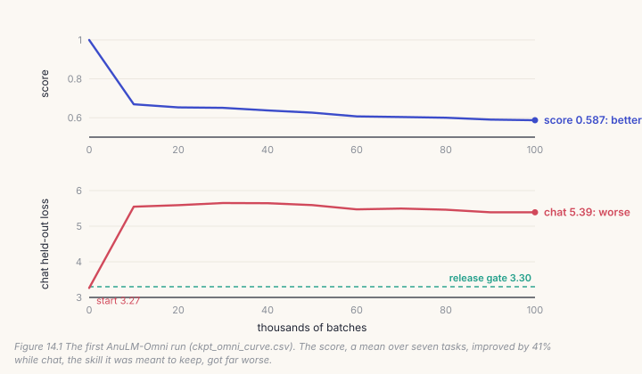
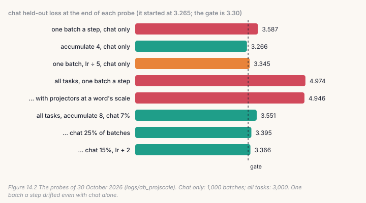
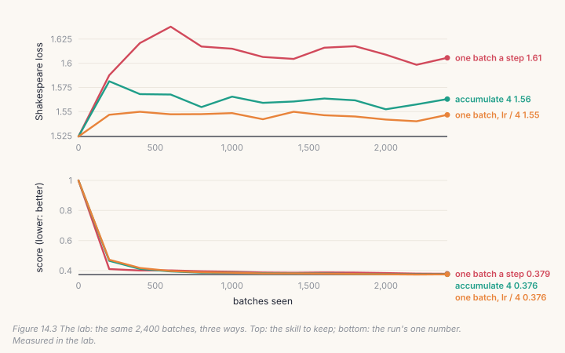

Until AnuLM-Omni, every skill in this project was its own full copy of the
model: a chat model, a reader, two speech models, a captioner and an
image-question model. Copies like that can't share a GPU and can't be released
as one thing. `omni_train.py` trains one decoder on all of it at once.

This chapter is about the code that does that, but mostly about what happened
the first time it ran: a 100,000-batch run whose single number improved by 41%
while the skill it was meant to keep got far worse. How the regression was
hidden, how it was found, the wrong first theory, and the probes that found
the real cause are the most useful things in this book that no tutorial
teaches.

## 14.1 One model, many tasks

Every task's batch reaches the model as the same thing: input vectors, and
targets with −1 on everything but the answer (Chapters 9 and 13). So one
optimizer and one backbone serve all of them. What differs per task is small:
how its inputs are built, and its share of the batches.

```python
# build/solutions/ch14.py, pick_task (omni_train.py's draw)
w = np.asarray(shares, dtype=float)
return int(rng.choice(len(w), p=w / w.sum()))
```

Shares are a policy, not a fact about the data. `experiments/omni_one.py`
gives Hindi speech 32% of the batches, because it is the weakest skill and
has the most data, and chat 25%, although the model starts as a chat model and
only has to *keep* chat. Why chat needed that much is the story of this
chapter.

## 14.2 One number for seven tasks

To pick the best checkpoint, `omni_train.py` needs one number. Each task's
held-out loss is divided by its value at step 0, and the ratios are averaged:

```python
# build/solutions/ch14.py, score (omni_train.py's)
return float(np.mean([losses[k] / first[k] for k in losses]))
```

Dividing by the start keeps a task with a big loss (captions) from drowning
out one with a small one (speech). The score starts at 1.0, and lower is
better. Here is what it did on the first run:



The score fell from 1.0 to 0.587. Every new skill improved enormously: the
intent classifier went from a held-out loss of 7.78 to 0.25. And chat, the
skill the model started with, went from **3.27 to 5.39** in the first 10,000
batches and never came back. A mean of seven ratios has no way to say that one
of them got worse while six got much better.

## 14.3 Finding the cause

The first theory was the projectors. Chapter 13 showed that a default
LayerNorm makes picture and audio vectors about 80 times louder than a word's
embedding. Perhaps the shared blocks retuned themselves to the loud inputs at
the expense of text. `_match_scale` was written to test it, and an A/B of
3,000 batches each gave chat **4.97** without it and **4.95** with it. The
theory was wrong.

So the probes took tasks *away*. If chat drifted when it trained alone, the
other tasks weren't the cause.



**Chat drifted even alone**: 3.27 → 3.59 in 1,000 batches through
`omni_train.py`, one batch a step. The same 1,000 batches summed four at a
time (250 steps) kept it at **3.27**. A fifth of the learning rate gave 3.35.

The cause was the steps themselves. AdamW moves every weight by roughly the
learning rate on every step, *whatever the batch held*, because it divides
the gradient by its own running size. A chat batch of 8 examples, or an intent
batch with about 30 answer tokens, is a noisy estimate of where to go, and
AdamW takes a full step in that direction anyway. A model that already sits
in a good spot for chat gets knocked out of it by 100,000 noisy full-size
steps. Summing several batches into one step averages the noise before the
step is taken:

```python
# build/solutions/ch14.py, omni_step
for _ in range(accum):
    x, y = draw()                       # any task
    _, loss = model(x, y)
    (loss / accum).backward()           # each batch's share of the mean
torch.nn.utils.clip_grad_norm_(model.parameters(), clip)    # once, on the sum
opt.step()
opt.zero_grad(set_to_none=True)
model.update_expert_biases()
```

With all seven tasks and eight batches a step, chat ended the same 3,000
batches at 3.55 instead of 4.97. Giving chat 25% of the batches brought it to
3.40, and 15% at half the learning rate to 3.37. The retrain uses all three
levers together: `ACCUM = 8`, chat's share 0.25, and `LR = 2.5e-5`. That
combination was never probed as a set, so its result will be the measurement.

## 14.4 Gates: a release decision that one number can't override

A score picks checkpoints. It must not decide releases. `omni_one.py` sets a
**gate** for each task: how much it may lose against the separate model it
replaces. If any gate fails, nothing is published, however good the mean.

```python
# experiments/omni_one.py, GATES (part)
"chat_heldout_loss": ("<=", 3.30),     # chat_v3: 3.146 by omni_eval.py
"wer_en": ("<=", 9.0),                 # asr_en_v3: 7.1% on the same 100 clips
"intent_banking77": (">=", 80.0),      # the Decide adapter: 89.0%
```

Your `gates` matches it. A measurement that is *missing* fails its gate: a
gate is a promise that something was measured. The Hindi speech gate is the
mean of three test sets, because each set alone pulled the decision a
different way: training on real speakers took Kathbath's error from 37.0% to
24.9% and MUCS's from 79.2% to 55.6%, while FLEURS got 3 points worse.

## 14.5 Catch it

```bash
python course/checks/ch14.py              # your build/post.py
python course/checks/ch14.py --self-test  # proves the checks catch their bugs
```

| check | the silent bug it catches |
|---|---|
| `tasks_are_drawn_like_omni_train` | shares ignored |
| `an_accumulated_step_is_one_large_batch` | losses not divided by the number of batches; the balancer not moved |
| `the_step_leaves_no_gradient_behind` | gradients not cleared: the next step adds to them |
| `gradients_are_clipped_once_over_the_sum` | each batch clipped on its own |
| `score_matches_omni_train` | the score as a ratio of raw means |
| `gates_match_omni_one` | a missing measurement passing; the Hindi mean never computed; a value exactly at the threshold failing |
| `a_gate_fails_when_one_task_regresses_even_if_the_score_improves` | — (the first Omni run, replayed) |

Two checks read the repository's own records. `score_matches_omni_train`
recomputes every score in `ckpt_omni_curve.csv` from the losses logged beside
it, and the last check replays that run: your score must call it a 41%
improvement, and your chat gate must still fail it. The self-test plants nine
bugs; all nine are caught.

## Lab: the same story on your machine

```bash
cd course/ch14-one-model
python lab.py                      # needs Chapter 8's base.pt; about five minutes on CPU
python lab.py --impl solution
python make_figures.py
```

Chapter 8's model already writes Shakespeare, the skill to keep. Two new tasks
join it: Chapter 9's sums and Chapter 10's Hindi. Shakespeare gets 15% of the
batches, sums 35%, Hindi 50%, batches of 8, and three runs see the same 2,400
batches in the same order:



| | score | Shakespeare | sums | Hindi |
|---|---|---|---|---|
| at the start | 1.0 | 1.524 | 16.03 | 17.10 |
| one batch a step | 0.379 | **1.606** | **0.494** | **0.917** |
| accumulate 4 | 0.376 | 1.563 | 0.723 | 0.997 |
| one batch, lr / 4 | 0.376 | **1.547** | 0.808 | 1.051 |

Held-out losses after 2,400 batches, measured in the lab.

**The score can't tell the three runs apart**: 0.379, 0.376, 0.376. They are
three different models. One batch a step learned the new tasks fastest and did
the most damage to the old one: Shakespeare got worse within 200 batches and
stayed there. Accumulating four batches halved the damage, and a quarter of
the learning rate did better still. Both paid for it in the new tasks, which
had fewer or smaller steps to learn in.

That last part differs from the 400M run, where eight batches a step kept
*every* task better at equal batches. Its batches were far noisier (an intent
batch has about 30 answer tokens). The lab's batches are 8 rows of 128 bytes,
every byte graded, so there is less noise to average away. What carries over
is the method, not the numbers: decide what you are protecting, measure it on
its own, and choose share, learning rate and accumulation for it.

## Code tour: the same pieces in the repository

- **`omni_train.py`**: the `Omni` class (line 127) builds every task's
  batches, with its projectors, as (vectors, targets). The training loop
  (line 256) is your `pick_task`, `omni_step` and `score`, plus resuming,
  bf16, and a log line that says how many batches each step sums.
- **`experiments/omni_one.py`**: `TASKS` (shares and batch sizes), `GATES`,
  and `gates` (line 250). It runs the whole pipeline: data, training,
  evaluation, the report, and publishing only if every gate passes.
- **`omni_eval.py`** measures each task the way its gate is written, on the
  same held-out sets as the separate models.
- **`logs/ab_projscale/`** holds every probe in this chapter.

> **From the lab notebook**
> The first run was interrupted by Windows Update: the machine rebooted
> itself to install an update. The run resumed from its last save, at batch
> 90,000. `<out>.last` is written at every evaluation and carries the
> optimizer, the step and the best score, so a reboot costs at most one
> evaluation interval, not the run.
>
> The diagnosis took one afternoon of probes, on 30 October 2026, after the
> report came back with four of seven gates failed. The first theory, the
> projectors' scale, took two runs and 55 minutes to rule out. What found the
> cause was the cheapest probe of all: train chat alone, through the same code,
> and watch it get worse.

## Try it on your own data

1. Give Shakespeare 40% of the batches instead of 15%. Does it still drift?
   What does it cost the new tasks?
2. Accumulate 4 *and* use lr / 4. Is the trade better than either alone?
3. Add a fourth task, Chapter 13's captions, at 20%. Does adding a task move
   Shakespeare?
4. Write a gate for the lab: Shakespeare may lose at most 0.03. Which runs
   pass?
5. *Open-ended:* replace the mean of ratios with the *worst* ratio. Would it
   have caught the first Omni run? What would it get wrong instead?

## Key takeaways

- One model can learn many tasks if every batch arrives in the same shape;
  shares of the batches are a policy you choose.
- A single score averages away a regression: the first Omni run improved by
  41% while chat went from 3.27 to 5.39.
- Probe by taking things away. Chat drifted on its own, which ruled out the
  other tasks and the projectors, and pointed at the steps.
- Many noisy one-batch AdamW steps knock a model out of a good spot. Summing
  batches into one step, a larger share, or a lower rate protects a skill,
  and the lab shows they can cost the new tasks.
- Release on gates, one per task, and fail any measurement that wasn't made.
