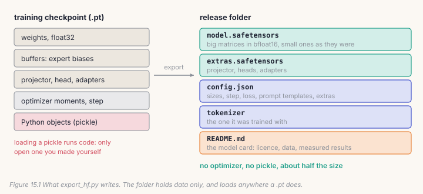
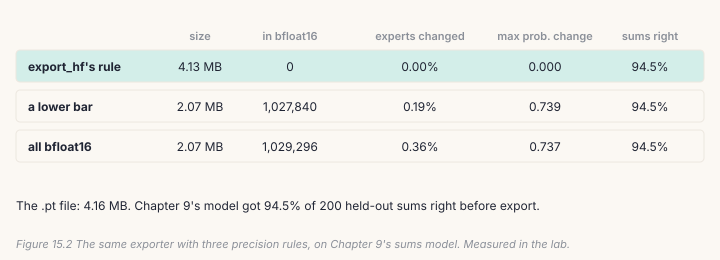
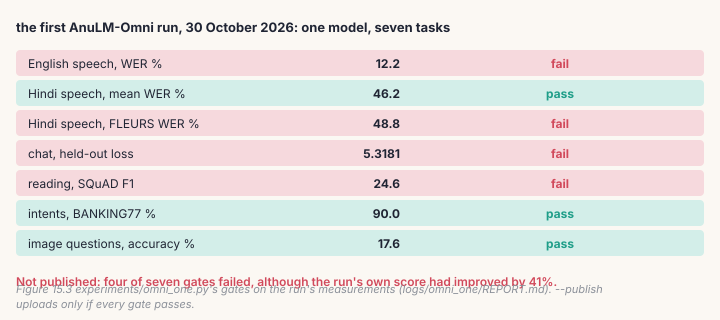

A model on your disk helps one person. Shipping it means four more jobs: a
file format other people can load safely, a statement of what the model is
and what it may be used for, a measured decision about whether it is good
enough, and something people can talk to. The bugs here are the ones your
users find: a release that lost its projector, router biases rounded away, a
model card that says "pass" for a measurement nobody made.

## 15.1 From a checkpoint to a release

A training checkpoint is a Python pickle: weights, buffers, the optimizer's
moments, the step, and whatever else was saved, often three times the size of
the weights. Loading a pickle can run code, so you should only ever open one
you made yourself. A release is different. `export_hf.py` writes a folder of
data only:



`safetensors` stores raw tensors and their names, and nothing that executes.
The weights go in as bfloat16, half the size of float32, but **not all of
them**:

```python
# build/solutions/ch15.py, to_bf16 (identical to export_hf.py's)
if v.is_floating_point() and v.numel() >= 100_000:
    v = v.to(torch.bfloat16)
```

Big matrices lose little in bfloat16. Small tensors are cheap to keep exact
and are often precision-sensitive: norm gains, and the experts' balancing
biases, which are small numbers that decide routing by small differences
(Chapter 7 measured 0.4% of routing choices flipping in bfloat16). Integer
buffers, such as the experts' load counts, must never be converted.

## 15.2 A release has to keep everything

A model that hears or sees is more than a language model: the projector,
a Decide head, LoRA adapters and their labels all live beside the backbone.
`tensor_groups` finds every one of them, as every dict of tensors in the
checkpoint other than the backbone's, and the export writes them to
`extras.safetensors`. Forget one and the release still loads. It just can't
see any more.

```python
# build/solutions/ch15.py, tensor_groups (identical to export_hf.py's)
return {k: v for k, v in ck.items() if k not in CORE_KEYS and isinstance(v, dict) and v
        and all(torch.is_tensor(t) for t in v.values())}
```

Loading reverses it: every bfloat16 tensor is widened back to float32, every
group returns under its own name, and the settings come from `config.json`.
In the repository, `model.load_checkpoint` accepts such a folder anywhere a
`.pt` path is accepted, so every script works on a release unchanged.

## 15.3 The release decision

Chapter 14's gates decide; the model card reports. `release_report` turns
measurements and gates into the table a card carries, and its last line is
the decision:

```python
# build/solutions/ch15.py, release_report
for k, (op, thr) in rules.items():
    v = results.get(k, "-")
    lines.append(f"| {k} | {v} | {op} {thr} | {'yes' if gate_results.get(k) else '**no**'} |")
ok = all(gate_results.get(k) for k in rules)
```

A missing measurement prints "-" and fails. The report shows the value the
gate actually judged, so when a gate computes a value (the Hindi mean), the
report has to show that value too. Our first version of this lab printed "-"
for the Hindi mean beside a "yes".

The card also carries the licence, and for a model the licence is decided by
its data. `docs/PUBLISHING.md` §1 lists every AnuLM release with its licence
and why: the coder is CC BY-NC-SA 4.0 because it was tuned on non-commercial,
share-alike exercises; the translator is CC BY-NC 4.0, research only, because
of Samanantar and the IIT Bombay corpus; AnuLM-Omni was built from
commercially usable data only, so it can be CC BY-SA 4.0 with commercial use
allowed. One set of weights inherits every training set's terms.

## 15.4 Catch it

```bash
python course/checks/ch15.py              # your build/post.py
python course/checks/ch15.py --self-test  # proves the checks catch their bugs
```

| check | the silent bug it catches |
|---|---|
| `precision_matches_export_hf` | router biases in bfloat16; integers converted; the threshold off by one |
| `extras_are_found_like_export_hf` | only projectors kept; a dict of strings treated as tensors |
| `a_release_keeps_every_part` | extras left out; the backbone rounded whole; bfloat16 not widened on loading |
| `the_released_model_answers_the_same` | the same, seen in the logits |
| `the_report_says_no_when_a_gate_fails` | a missing measurement passing; a summary that always says publish |

The self-test plants ten bugs; all ten are caught. The report check uses the
first AnuLM-Omni run's real measurements and `omni_one.py`'s real gates.

## Lab: release the sums model, then decide about Omni

```bash
cd course/ch15-shipping
python lab.py                      # needs Chapter 9's sft.pt; under a minute on CPU
python lab.py --impl solution
python make_figures.py
```

**Part 1.** Your exporter writes Chapter 9's sums model three times, each with
a different precision rule, and loads each one back:



With `export_hf.py`'s rule, *nothing* is converted: no tensor in this model
reaches 100,000 numbers (the largest, the embedding table, has 33,152). The
folder is the same size as the `.pt` and the model comes back bit for bit.
On the 400M model, the matrices have millions of numbers, and the same rule
halves the file.

Lower the bar to 1,000 numbers and the folder halves here too, 4.13 MB to
2.07 MB. The sums model still got all the same sums right: 94.5%. But it is
not the same model. 0.19% of the expert choices changed, and at one position
the probability of the next byte moved by 0.74. Convert everything, router
biases included, and twice as many expert choices changed. The answers you
check survived; you can't know about the ones you didn't check.

**Part 2.** The first AnuLM-Omni run's measurements, through `omni_one.py`'s
gates and your report:



Four of seven gates failed: chat (5.32 against a limit of 3.30), English
speech (12.2% WER against 9.0%), Hindi speech on FLEURS (48.8% against 43.0%)
and reading (F1 24.6 against 30.0). Its own score had improved by 41%. It
was not published. After the fixes in Chapter 14 (more steps per update, a
shorter run with gate-aware checkpoint choice, and new human-written chat data),
the run of 2026-11-06 passed all seven gates and was published.

## Code tour: the same pieces in the repository

- **`export_hf.py`**: `to_bf16` (line 50), `front_matter` (line 71), which
  writes the card's YAML header (licence, languages, pipeline tag, datasets,
  base model), and `tensor_groups` (line 105). `--adapter-of` exports an
  adapter without its backbone, with only the id of the model it was trained
  on.
- **`configuration_anulm.py`** and **`modeling_anulm.py`** let the folder load
  through `transformers`' `AutoModelForCausalLM`. `tools_hf_upgrade.py` adds
  them to an existing folder and refuses to finish unless the logits and a
  greedy continuation match this repository's own model.
- **`serve.py`** is a small web page for one checkpoint; **`api.py`** serves
  every model behind OpenAI-compatible endpoints (`/v1/chat/completions`,
  `/v1/audio/transcriptions`, `/v1/decide`); **`app_omni.py`** is the demo
  app.
- **`docs/PUBLISHING.md`** is the release checklist: licences, repository
  hygiene, export, the `transformers` layer, and what to do after release.

> **From the lab notebook**
> `docs/PUBLISHING.md` §3b has a rule in bold, and a reason for it:
> never re-upload the weights to fix a small file. The `.pt` checkpoints that
> the first four releases came from no longer exist, so the folders in
> `release/` and on the Hub are the only copies. Upgrading those releases to
> load through `transformers` meant uploading six small files per model, and
> no weights.

## Try it on your own data

1. Export your Chapter 13 model, projector included, with your
   `export_folder`. Load it back and caption a picture. Then delete
   `extras.safetensors` and try again. What fails, and how loudly?
2. Find the smallest bar (in numbers per tensor) at which the sums model's
   accuracy changes.
3. Write the YAML front matter for your own model: licence, languages,
   datasets. Which of your training sets decides the licence?
4. Add a gate of your own to the lab's report: Chapter 9's sums at least 90%.
   Does the bfloat16 export pass it?
5. *Open-ended:* write the model card for the sums model. What should a user
   know that the numbers don't say?

## Key takeaways

- Release data, not pickles: `safetensors`, `config.json`, the tokenizer, and
  a card.
- bfloat16 for big matrices only. Router biases, norms and integers keep their
  precision. On the lab's model, rounding everything changed 0.36% of expert
  choices and no answer it was checked on.
- A release keeps everything the model needs: projectors, heads, adapters.
- Gates decide, and a missing measurement fails. The first AnuLM-Omni run
  failed four of seven gates while its score improved by 41%, and was not
  published.
