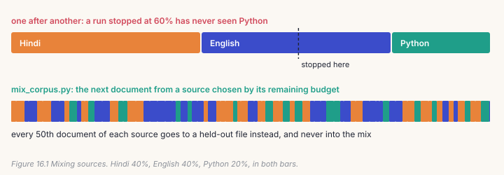
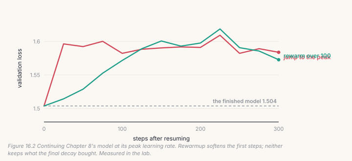
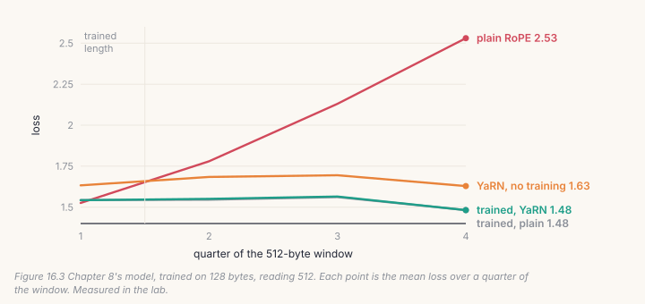

A pre-training run ends, and then you want more from it: more data, a new
language, a longer window. Starting again costs the whole run. Continuing
costs a fraction of it, if you continue correctly. This chapter is about the
three ways continuing goes wrong quietly: the learning rate on resume, a mix
of sources that isn't a mix, and a window longer than the model was trained
on. Your code goes in a new file for Part V, `course/build/further.py`.

> **From the lab notebook**
> `docs/RESULTS.md` §28 continued `AnuLM-Base-400M` for 10,000 steps at a
> window of 2,048 tokens, four times its training length, with YaRN: 82M more
> tokens, five hours on one GPU. The first evaluation showed the same gain,
> −0.72, at every position in the window. That is the shape of a mistake, not
> a finding. The evaluation read the last 10% of a file that had gone into the
> training mix whole: nine probe passages out of nine appeared verbatim in the
> training data. A held-out slice of a *file* is not held out if the file went
> into the mix.

## 16.1 Resuming: the learning rate

A finished run ends at its minimum learning rate. Extend it with more steps
and the schedule jumps back to a rate several times larger than any the
weights have seen for a long time. `train.py --rewarmup N` ramps up to the
schedule over N steps instead:

```python
# build/solutions/ch16.py, rewarm (identical to train.py's --rewarmup)
if rewarmup and start_step and step < start_step + rewarmup:
    return lr * (step - start_step + 1) / rewarmup
return lr
```

The `+ 1` matters: without it, the first step after resuming has a learning
rate of exactly zero, and the optimizer's moments take a step of nothing.

## 16.2 Mixing sources

Continued pre-training on new data needs some of the old data too
(Chapter 9's replay), so the training file is a mix. `mix_corpus.py` builds it
one document at a time, choosing the source in proportion to its *remaining*
budget:



```python
# build/solutions/ch16.py, mix_documents (mix_corpus.py's rule)
n = rng.choices(live, weights=[state[k]["left"] for k in live])[0]
...
if s["count"] % heldout_every == 0:
    held[n].append(doc)          # every 50th document: held out, never mixed in
    continue
```

Two properties follow, and both are checked. The mix is even along the file:
stop a run anywhere, and it has seen every source in about its share. And the
held-out set is cut from each source *before* mixing, so no held-out
document can be in the training data. §28's false result came from getting
the second one wrong.

## 16.3 Measuring by position

One average over a window hides exactly what extension changes, so
`eval_context.py` measures the loss in each quarter of the window:

```python
# build/solutions/ch16.py, loss_by_position (eval_context.py's eval_by_position)
tok = F.cross_entropy(logits[0].float(), y[0], reduction="none")
for b in range(bins):
    totals[b] += tok[edges[b]: edges[b + 1]].mean().item()
```

A model that fails past its trained length gets worse quarter by quarter. A
model that has learned to use the longer window gets *better* towards the end,
because it has more text to go on.

## 16.4 A longer window: YaRN on your model

Chapter 5 built YaRN's rotary table: the slow frequencies stretched by the
extension factor, the fast ones kept, and an attention temperature to
compensate. `extend_context` puts it into a trained model:

```python
# build/solutions/ch16.py, extend_context
model.block_size = block_size
model.rotary = Rotary(model.rotary.dim, rope_theta, yarn=True, yarn_factor=factor,
                      yarn_original_context=original_context)
scale = model.rotary.dim ** -0.5 * model.rotary.attn_mscale ** 2
for layer in model.layers:
    layer.attn.scale = scale                 # the temperature: easy to forget, and it matters
```

No weight changes. The check loads your extended model into `model.py`'s
`AnuLM` configured with YaRN and requires the same logits at positions
neither has trained on.

## 16.5 Catch it

```bash
python course/checks/ch16.py              # your build/further.py
python course/checks/ch16.py --self-test  # proves the checks catch their bugs
```

| check | the silent bug it catches |
|---|---|
| `a_resumed_run_ramps_back_up_like_train_py` | the rate jumping on resume; a ramp that starts at zero |
| `held_out_documents_never_enter_the_mix` | held-out documents also mixed in |
| `the_mix_follows_the_budgets` | the budgets ignored |
| `the_mix_is_even_along_the_file` | sources one after another; sources drawn uniformly |
| `loss_is_measured_by_position_like_eval_context` | one average copied to every position |
| `your_extended_model_is_model_py_with_yarn` | YaRN without its temperature; plain RoPE; the wrong original length |

The self-test plants nine bugs; all nine are caught. Writing the YaRN check
caught a bug in the check itself: without targets, `model.py` returns logits
for the last position only (that is all generation needs), so comparing the
two models' outputs that way compared different positions. The check now
passes targets, as Chapter 7's does.

## Lab: continue Chapter 8's model

```bash
cd course/ch16-continue
python lab.py                      # needs Chapter 8's base.pt; about eight minutes on CPU
python lab.py --impl solution
python make_figures.py
```

Chapter 8's model finished its schedule at the minimum learning rate, with a
validation loss of **1.504** on the 128-byte windows it trained on.

**Part 1: resuming.** Continue it on the same text at its peak rate, 10⁻³, for
300 steps: once jumping straight there, once ramping up over 100 steps.



Jumping costs 0.09 within 25 steps: 1.504 to 1.596. The rewarmup softens that
(1.514 after 25 steps, 1.529 after 50), but by step 150, at the full rate,
it has lost just as much. After 300 steps, the two runs are at 1.584 and 1.573.
Neither keeps what Chapter 8's final decay bought.

That is the lesson. A decay is where a run collects much of its final loss
(Chapter 8: 1.607 → 1.526 for a copy). Continuing at the peak rate gives it
back, and rewarmup only changes how quickly. A continued run must decay again
at its end, which is why `train.py`'s warmup-stable-decay schedule exists:
decay a copy whenever you need a model, keep the main run at its peak.

**Part 2: a longer window.** Read windows of 512 bytes, four times the
trained length:



| loss by quarter of the window | 1st | 2nd | 3rd | 4th | last − first |
|---|---|---|---|---|---|
| plain RoPE | 1.525 | 1.780 | 2.130 | 2.531 | **+1.006** |
| YaRN, no training | 1.633 | 1.684 | 1.695 | 1.629 | −0.004 |
| 400 steps at 512, plain RoPE | 1.543 | 1.546 | 1.561 | 1.482 | −0.061 |
| 400 steps at 512, YaRN | 1.542 | 1.550 | 1.565 | 1.482 | −0.060 |

Measured in the lab, 40 windows of 512 bytes.

**With plain RoPE, the model falls apart past its trained length**: the last
quarter is a full nat worse than the first. **YaRN alone fixes the slope**, with
no training at all, but it costs 0.11 at the positions the model knew (1.633
against 1.525). **400 steps at the longer length fix both, and then YaRN
doesn't matter**: the two trained runs end within 0.004 of each other, and
both do better at the end of the window than at the start.

§28 found the same shape on the 400M model at 2,048 tokens: YaRN with no
training turned the slope from +0.073 to −0.068; five hours of training took
it only to −0.085. The rotary change is what makes a model usable at a longer
length right away. Training buys something else: more data.

## Code tour: the same pieces in the repository

- **`train.py`**: `lr_at` (line 248) is Chapter 8's schedule plus
  `--rewarmup` (lines 263–269). A run is resumed with `--resume` and a larger
  `--steps`.
- **`mix_corpus.py`** streams sources of any size into one file, holding out
  every 50th document of each into `data/bench_<name>.txt`, and writes a
  tokenizer sample from the same mix.
- **`eval_context.py`**: `eval_by_position` (line 90) is yours. It also
  compares plain RoPE and YaRN at several lengths with no retraining, and
  pairs each window across the two so their difference has an error bar.
- **`model.py`**: YaRN is configuration (`yarn`, `yarn_factor`,
  `yarn_original_context`), so a checkpoint carries how it reads long windows.

## Try it on your own data

1. Resume with rewarmup, then decay over the last 100 of 300 steps. Do you
   get back to 1.504, or below it?
2. Mix Shakespeare 70% with Hindi 30% using `mix_documents`, continue the
   model on it, and measure both languages. Compare with Hindi alone.
3. Extend to 1,024 bytes (factor 8) with YaRN and no training. Where does the
   slope turn upward again?
4. Train at 512 with plain RoPE for only 100 steps. Is it already as good as
   YaRN with no training?
5. *Open-ended:* make the evaluation leak on purpose: evaluate on the last 10%
   of `input.txt` after training on all of it. How big is the false gain?

## Key takeaways

- A finished run sits at its minimum learning rate. Continuing at the peak
  undoes the final decay (1.504 → 1.58 in the lab); rewarmup only softens the
  first steps. Decay again at the end.
- Mix sources by remaining budget so every stretch of the file has every
  source, and cut the held-out set from each source before mixing.
- Measure long windows by position: one average hides the failure.
- YaRN makes a longer window usable with no training (slope +1.006 → −0.004);
  training at the length matters more than the rotary choice once you do it.
