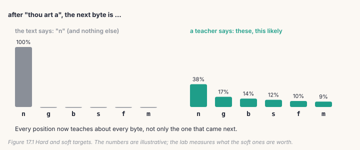
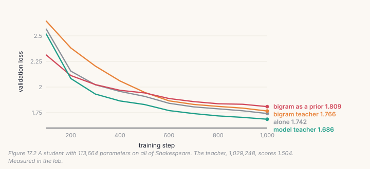
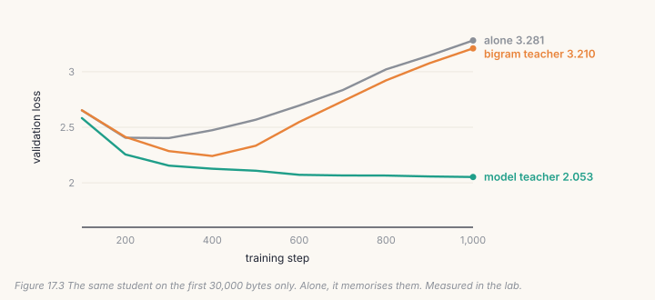

A training example tells the model one thing: which token came next. A
teacher can tell it much more: how likely *every* token was. Training a
student on a teacher's whole distribution is **distillation**. It is how
small models are made from big ones, and the repository uses a version of it
with no teacher model at all. This chapter builds both, and measures when a
teacher is worth having.



## 17.1 A teacher that costs one count: the bigram

`bigram_teacher.py` counts, over the training data, which token follows
which. For every previous token it keeps the 32 most frequent next tokens and
how much more likely each is after that token than in general:

```python
# build/solutions/ch17.py, build_bigram_teacher (identical to bigram_teacher.py's)
lam = n / (n + 5.0)                                     # seen only a few times? lean on the unigram
p_bi = lam * cnt.float() / n.clamp(min=1) + (1 - lam) * uni[nxt] / uni.sum()
resid = p_bi.log() - log_uni[nxt]
```

During training, a KL term pulls the model's prediction after each token
towards the teacher's:

```python
# build/solutions/ch17.py, teacher_kl (identical to bigram_teacher.py's)
z = log_uni.expand(*x.shape, -1).scatter_add(-1, idx[x], val[x])     # the teacher's logits after x_t
return F.kl_div(F.log_softmax(logits.float(), -1), F.log_softmax(z, -1),
                log_target=True, reduction="none").sum(-1).mean()
```

The direction matters: `F.kl_div(input, target)` computes KL(target ‖ input),
so the teacher is the target and the model is pulled to cover what the teacher
thinks is likely.

## 17.2 A teacher must step aside

A bigram is a crude model of language. Early in training it knows more than
the student; later, much less. So its weight fades to zero:

```python
# build/solutions/ch17.py, teacher_weight (identical to bigram_teacher.py's)
return weight * max(0.0, 1.0 - step / max(until * steps, 1))
```

`train.py --bigram-teacher 2.0 --teacher-until 0.5` fades it out by half-way.
The `max(0.0, ...)` is easy to drop and costly: without it the weight goes
negative, and the second half of training pushes the model *away* from the
bigram.

## 17.3 A model as teacher

The classic version (Hinton et al., 2015) uses a bigger trained model. Both
distributions are softened by a temperature *T*, and the soft part of the loss
is multiplied by *T*², because softening shrinks its gradients by about that
much:

```python
# build/solutions/ch17.py, kd_loss
soft = F.kl_div(F.log_softmax(s / T, -1), F.log_softmax(t / T, -1), log_target=True,
                reduction="batchmean") * T * T
hard = F.cross_entropy(s, targets.reshape(-1)[mask])
return alpha * soft + (1 - alpha) * hard
```

The teacher's logits are detached: the teacher is frozen, and only the student
learns. The repository has no model-teacher distillation yet; this is new
code.

## 17.4 Catch it

```bash
python course/checks/ch17.py              # your build/further.py
python course/checks/ch17.py --self-test  # proves the checks catch their bugs
```

| check | the silent bug it catches |
|---|---|
| `the_bigram_teacher_matches_bigram_teacher_py` | counts with no unigram blend; the rarest next tokens kept |
| `the_kl_matches_bigram_teacher_py` | the KL the wrong way round |
| `the_teacher_fades_like_train_py` | a fade that goes negative |
| `distillation_matches_the_formula` | no T²; the temperature on the teacher only; positions without a target distilled |
| `only_the_student_learns` | the teacher not detached |

The self-test plants eight bugs; all eight are caught.

## Lab: a small student, two kinds of teacher

```bash
cd course/ch17-distill
python lab.py                      # needs Chapter 8's base.pt; about seven minutes on CPU
python lab.py --impl solution
python make_figures.py
```

The student has **113,664** parameters, a ninth of Chapter 8's model, the
teacher (1,029,248 parameters, validation loss 1.504). It trains from scratch
for 1,000 steps, four ways: alone; with the bigram teacher (weight 2, fading by
half-way); with the bigram added to its logits for good; and with the model
teacher (90% of the loss from the teacher's distribution, temperature 1).



**On all of Shakespeare, the model teacher helped: 1.686 against 1.742.**
**The bigram teacher did not: 1.766.** And the bigram as a permanent prior was
the worst, 1.809, as it was on the 400M model's proxy runs.

Why didn't the bigram help here, when it helped the repository? Its tokens.
`bigram_teacher.py` was measured with a 32,000-token vocabulary, where a token
is often a word and the next-word distribution is real knowledge that takes a
model a long time to learn. Over bytes, the next byte after "q" is something a
student learns in its first hundred steps. A teacher is worth what it knows
that the student doesn't yet.

**Now give the student very little data**, the first 30,000 bytes of the
training text, 3% of it:



Alone, the student memorises its 30,000 bytes: validation loss is best at
step 300 (2.403) and then climbs to **3.281**. The bigram teacher slows the
memorising for a while (best 2.242 at step 400), then follows. **With the model
teacher, the student never overfits**: 2.053 at the end, still improving. Every
position now carries the teacher's whole distribution instead of one byte, so
the same 30,000 bytes hold far more to learn, and the student can't simply
memorise them.

That is distillation's real use: when data is scarce or expensive, a teacher
multiplies what each example teaches.

## Code tour: the same pieces in the repository

- **`bigram_teacher.py`**: `build_bigram_teacher` (line 34), `teacher_kl`
  (line 65) and `teacher_weight` (line 73) are yours, on the GPU.
- **`train.py`**: `--bigram-teacher` and `--teacher-until` (line 480). The KL
  is added to the loss inside the step (lines 698–701), and it needs the full
  logits, so it can't be combined with `--ce-chunk`, which never builds them.

> **From the lab notebook**
> On the three-language proxy (25M tokens, `docs/RESULTS.md`, "the lab"), the
> bigram teacher took the held-out loss from 4.946 to 4.728 at weight 1, and
> to 4.692 at weight 2, and repeated on a second seed. Fading it at 80% of the
> run instead of 50% gave back a third of the gain: a teacher must step aside.
> The same statistics added permanently to the logits gave 5.473, the worst
> idea tested that week: a fixed prior has to be un-learned wherever it is
> wrong, and soft targets don't.

## Try it on your own data

1. Use the model teacher at temperature 2 and 4. Which is best on full data,
   and on 30,000 bytes?
2. Give the student only the teacher's distribution (alpha 1). Does it still
   learn the actual bytes?
3. Run the bigram teacher with a BPE tokenizer from Chapter 3 (vocabulary
   1,024). Does it help now?
4. Distil the Chapter 9 sums model into the small student, on sums only. How
   few questions does it need?
5. *Open-ended:* fade the model teacher out like the bigram. Does a student
   that ends on its own beat one that keeps its teacher to the end?

## Key takeaways

- Distillation trains on a teacher's whole next-token distribution, not only
  the token that came next.
- The bigram teacher is distillation with no teacher model; it must fade out,
  and its value depends on the tokens (it didn't help over bytes).
- A model teacher helped on full data (1.686 against 1.742) and transformed
  the small-data run: 2.053 against 3.281 for a student that memorised.
- KL(teacher ‖ student), T² on the soft part, the teacher detached: each is a
  silent bug when wrong.
