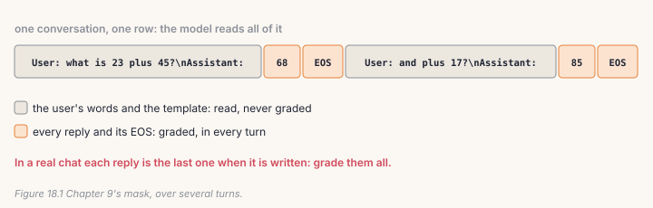
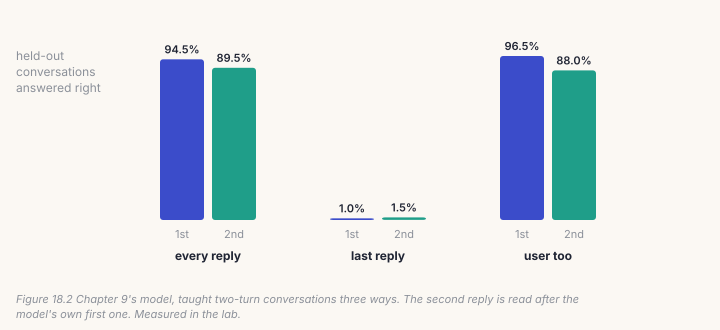

Chapter 9 taught a model to answer one question. A chat is a conversation:
the second question only makes sense after the first answer. This chapter
extends Chapter 9's mask to many turns, measures what grading which turns
does, and looks at how `make_chat.py` builds the repository's chat data,
including a leak in its held-out set that this chapter's checks are written to
prevent.

## 18.1 Many turns, every reply graded

Each turn is a template with the user's words, then the reply and an end
token. Turns follow one another in one sequence, and *every* reply is graded:



```python
# build/solutions/ch18.py, conversation_ids
for user, reply in turns:
    p = encode(template.format(q=user))
    a = encode(" " + reply) + [eos]
    ids += p + a
    labels += [-1] * len(p) + a
```

With one turn and Chapter 9's template, this gives exactly `finetune.py`'s
ids, which the checks confirm. Two details carry over from Chapter 9 and
matter more here. The EOS after *each* reply is what makes the model stop and
hand the turn back. And a common shortcut, grading only the last reply of each
conversation, sounds harmless; the lab shows what it does.

## 18.2 Packing conversations

`pack_conversations` is Chapter 9's `pack` for (ids, labels) pairs: whole
conversations share rows, none is ever cut in two, and padding is never
graded. A conversation cut across rows would leave its second half, a reply
to a question in another row, as a reply to nothing.

## 18.3 The data, and an honest held-out set

`make_chat.py` builds the repository's chat set from five sources, all
human-written and licensed for use: Dolly-15k (English), the first turn of
each OpenAssistant conversation with its best-rated reply, Aya's native Hindi
rows, 4,000 Hindi Wikipedia questions from `make_qa.py`, and a dozen "who are
you?" rows, repeated 20 times so a model this small learns them. Replies longer
than 1,500 characters are dropped, and 300 random rows are held out, never
identity rows.

It holds out *rows*. When two sources ask the same question, one copy can land
in training and the other in the held-out set. Your `split_heldout` holds out
*questions*: every copy of a held-out question, compared without case or
extra spaces, goes with it.

## 18.4 Catch it

```bash
python course/checks/ch18.py              # your build/further.py
python course/checks/ch18.py --self-test  # proves the checks catch their bugs
```

| check | the silent bug it catches |
|---|---|
| `one_turn_is_finetune_py` | the user's turns graded |
| `every_reply_is_graded_and_nothing_else` | only the last reply graded; no EOS after each reply |
| `single_turns_pack_like_finetune_py` | conversations cut across rows |
| `a_conversation_is_never_cut` | the same, for conversations of several turns |
| `the_held_out_set_asks_nothing_training_answered` | `make_chat.py`'s split, where copies leak; identity rows held out; long answers kept |

The self-test plants seven bugs; all seven are caught. Its first run missed
one: holding out identity rows went unnoticed, because the test data had a
single identity question and a random split rarely picked it. The check now
has many.

## Lab: two-turn sums

```bash
cd course/ch18-chat
python lab.py                      # needs Chapter 9's sft.pt; about nine minutes on CPU
python lab.py --impl solution
python make_figures.py
```

Every conversation has two turns, and the second depends on the first:

```
User: what is 23 plus 45?
Assistant: 68
User: and plus 17?
Assistant: 85
```

Three runs start from Chapter 9's model, which already answers single sums,
and train 1,500 steps on 6,000 conversations. Then each holds 200 new
conversations the way a chat really happens: the second question follows the
model's *own* first reply.



| graded | first reply | second reply | second, after a correct first |
|---|---|---|---|
| **every reply** | **94.5%** | **89.5%** | 95.0% |
| last reply only | 1.0% | 1.5% | 92.5% |
| everything, the user too | 96.5% | 88.0% | 91.5% |

Measured in the lab, 200 held-out conversations.

**Grading only the last reply broke the model.** It learned second replies
well (92.5% when given a correct first answer) and forgot how to give a first
one: 1.0%. Chapter 9's model knew sums, but in a different template, and this
run never graded a reply in the new one at the start of a conversation. In a
real chat, every reply is the last one at the moment it is written, so every
reply must be trained.

**Grading the user's words too cost little here** (88.0% against 89.5% on the
second reply), unlike Chapter 9's 57.5% against 94.5%. This model already
knew the task; the question's random numbers were a small part of a long
conversation. It is still wasted gradient, and on a model that is still
learning, Chapter 9 shows what it costs.

**Errors compound.** Every run does better on the second reply when its first
reply was right. In a long chat, a model that is 95% right per turn is right
on all of ten turns only 60% of the time.

**Part 2 counts the leak** in the repository's own chat data: 4 of the 300
held-out questions in `data/chat_heldout.jsonl` are also in
`data/chat_train.jsonl`, 2 of them with the same answer. The chat gate in
Chapter 14 (held-out loss ≤ 3.30) is measured on that set, so 1.3% of it was
seen in training. The effect on the number is small, but a held-out set is a
promise, and this one was slightly broken.

## Code tour: the same pieces in the repository

- **`make_chat.py`**: `dolly`, `oasst2` (the first turn of each conversation
  tree and its rank-0 reply), `aya_hindi`, `hindi_wiki_qa`, and the identity
  rows; `main` (line 97) filters, shuffles and splits. Its model is
  single-turn: every row is one question and one answer.
- **`finetune.py`** trains on those rows exactly as Chapter 9 describes, with
  the English and Hindi templates in `make_qa.PROMPTS`.
- **`app_omni.py`** and **`api.py`** answer each message on its own: the app
  tells its users the model "does not remember earlier ones", and the API's
  chat endpoint answers the last user message. The deployed model is
  single-turn, and so is its data. A multi-turn AnuLM needs both halves of
  this chapter: conversations in the training data, and serving code that
  sends the earlier turns back with each new message.

## Try it on your own data

1. Change `make_chat.py`'s split to `split_heldout` and rebuild the chat set.
   Does the chat model's held-out loss move?
2. Train on single turns only (Chapter 9) and test two-turn conversations.
   How far does the second reply fall?
3. Add a third turn ("and minus 9?"). How does accuracy fall from turn to turn?
4. Mix 20% single-turn questions into the two-turn data. Does the first reply
   improve?
5. *Open-ended:* write a conversation where the user corrects the model ("no,
   that's wrong"). What should be graded?

## Key takeaways

- A conversation is Chapter 9's mask over many turns: grade every reply and
  its EOS, never the user.
- Grading only the last reply looks harmless and broke the model: first
  replies 1.0% right.
- Errors compound across turns; measure turns with the model's own earlier
  replies.
- Hold out questions, not rows: 4 of the repository's 300 held-out chat
  questions were also in training.
