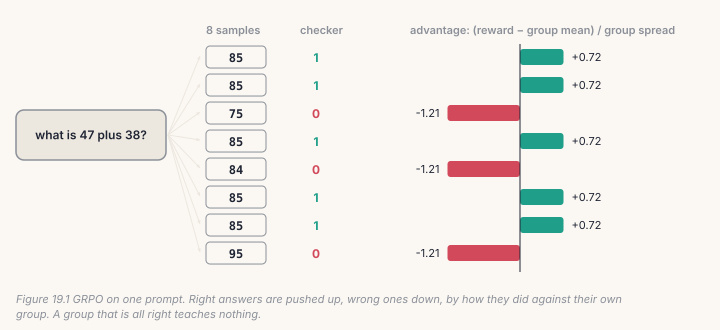
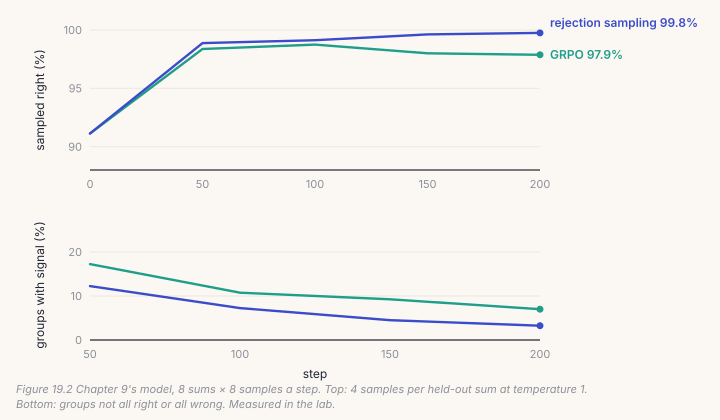

Fine-tuning needs the right answer written down. Reinforcement learning needs
only a way to *score* an answer the model wrote itself. For anything a program
can check (a sum, a unit test, a format, a fact looked up), the program is the
reward, and the model can practise on its own output. This chapter builds
**GRPO** (group relative policy optimisation; Shao et al., 2024, from
DeepSeekMath), the method behind much recent reasoning training, and puts it
against the simplest alternative.

The repository has no RL code; this is new.

## 19.1 The reward is a program

```python
# build/solutions/ch19.py, reward
return 1.0 if reply.strip() == answer else 0.0
```

It is one line, and it is the whole definition of what the model will learn.
Reinforcement learning finds whatever the reward accepts. A checker that
accepts a reply that merely *starts with* the answer will be satisfied by
"68 apples"; one that accepts a reply that *contains* it will be satisfied by
"6 or 68 or 680". Both are among the planted bugs, and both would train
happily.

## 19.2 Better than its own group

For each prompt, GRPO samples a *group* of answers and scores each. An
answer's **advantage** is how much better it did than the group's average,
in units of the group's spread:



```python
# build/solutions/ch19.py, group_advantages
mean = rewards.mean(dim=1, keepdim=True)
std = rewards.std(dim=1, keepdim=True)
return torch.where(std > 0, (rewards - mean) / (std + eps), torch.zeros_like(rewards))
```

The group replaces the value model that older methods (PPO) train beside the
policy: the other answers to the same prompt are the baseline. And a group
whose answers all scored the same, all right or all wrong, has an advantage of
zero for everyone. It teaches nothing, and that turns out to be the limit of
the method.

## 19.3 The loss

Each answer's log-probability is pushed up by its advantage, divided by its
length so a long answer doesn't count for more, with a pull back towards the
starting model (the reference, as in Chapter 11's DPO):

```python
# build/solutions/ch19.py, grpo_loss
pg = -(advantages.detach() * logp / lengths).mean()
d = (ref_logp.detach() - logp) / lengths
kl = (torch.exp(d) - d - 1).mean()                 # zero when they agree, never negative
return pg + beta * kl
```

The KL estimate exp(*d*) − *d* − 1 is the one GRPO uses. The plain log ratio
*d* has the same average but can be negative on any one answer, so a loss that
uses it can *reward* drifting away from the reference on some batches.

## 19.4 Catch it

```bash
python course/checks/ch19.py              # your build/further.py
python course/checks/ch19.py --self-test  # proves the checks catch their bugs
```

| check | the silent bug it catches |
|---|---|
| `the_checker_rewards_only_the_right_answer` | rewarding replies that start with, or contain, the answer |
| `advantages_are_relative_to_the_group` | raw rewards; normalised over the batch; centred but not scaled |
| `a_group_that_all_agree_teaches_nothing` | advantages on groups with nothing to teach |
| `the_loss_matches_the_formula` | the sign flipped; no division by length |
| `the_kl_is_zero_at_the_start_and_never_negative` | a plain log ratio as the KL |
| `the_gradient_raises_the_better_answers` | the advantage sign; the reference not detached |

The self-test plants nine bugs; all nine are caught.

## Lab: practice with a checker

```bash
cd course/ch19-rl
python lab.py                      # needs Chapter 9's sft.pt; about three minutes on CPU
python lab.py --impl solution
python make_figures.py
```

Chapter 9's model gets 94.5% of held-out sums right greedily, and 91.1% when
it samples at temperature 1. Each step, it answers 8 training sums 8 times
each, and the checker scores every answer. Two ways to learn from the same
samples, 200 steps each:

- **GRPO**, as above, beta 0.04;
- **rejection sampling**: fine-tune on the answers that were right, ignore the
  rest (Chapter 11's winner, now on the model's own samples).



**Both worked, fast.** By step 50 both answered every held-out sum right
greedily. After 200 steps: GRPO 99.5% greedy, 97.9% sampled; rejection
sampling 100% greedy, 99.8% sampled. Starting from 91.1% of samples right, both
taught the model to be right nearly every time it samples, which is what
"reasoning practice" buys: the model already *could*, and now it reliably
*does*.

**The signal runs out.** At the starting accuracy (91.1% of samples right),
about half of all groups of eight would have had some right and some wrong
answers (1 − 0.911⁸ ≈ 53%). As the model improved, almost every group came back
all right: over the last 50 steps, only 7% of GRPO's groups taught anything, and
3% of rejection sampling's. That is RL's ceiling on a task the model has
mastered, and it is why reasoning training moves to harder prompts as the
model learns: the prompts worth practising on are the ones it gets right
sometimes.

**Here, rejection sampling did slightly better.** When the reward is simply
right or wrong, keeping the right answers already carries most of the signal.
GRPO's advantage is in what rejection sampling can't do: use partial credit
(a reward of 0.5 for the right format with the wrong number), and push wrong
answers *down* rather than merely not up.

## Code tour: where this would go in the repository

There is no RL in AnuLM yet. If you add it, the pieces are already here:

- **sampling**: `model.generate` with `eos_id`, batched, as the lab does;
- **rewards that need no people**: the sums checker; `eval_code.py`'s
  sandbox, which runs generated Python against tests, is a reward for code;
  Decide's calibrated labels (Chapter 12) are one for classification;
- **log-probabilities**: Chapter 11's `answer_logprobs`;
- **the reference**: a frozen copy, or the same model with LoRA adapters
  switched off (Chapter 10);
- **the step**: `train.py`'s optimizer, clipping and `update_expert_biases`.

## Try it on your own data

1. Give partial credit: 0.5 when the reply is a number with the right number
   of digits. Does GRPO now beat rejection sampling?
2. Set beta to 0, then to 0.5. What happens to the KL, and to accuracy?
3. Train on three-digit sums, which Chapter 9's model rarely gets right. How
   many groups have any signal at the start, and does GRPO get anywhere?
4. Keep only prompts whose groups were mixed last time. Does learning speed
   up as the model improves?
5. *Open-ended:* write a reward for the Chapter 18 conversations that checks
   both turns. What should a reply that is right on the first turn and wrong on
   the second earn?

## Key takeaways

- With a program as the reward, a model can practise on its own answers; the
  checker defines exactly what is learned.
- GRPO compares each answer with its own group: no value model, and no signal
  from groups that all agree.
- Use a KL estimate that is never negative, divide by length, detach the
  reference and the advantages.
- In the lab, both GRPO and rejection sampling took sampled accuracy from
  91.1% to about 98–100%; the share of groups with anything to teach fell to
  7%.
