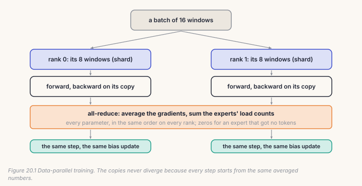
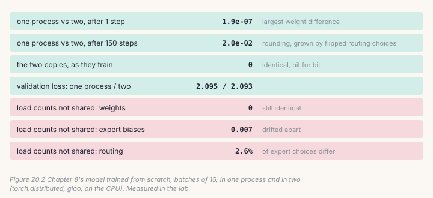

Every run in this repository used one GPU. The moment a model or a deadline
outgrows one card, the standard next step is **data parallelism**: a copy of
the model on every GPU, each copy reading a different part of every batch,
and the copies averaging their gradients so that they all take the same step.
PyTorch's `DistributedDataParallel` does it in one line. This chapter writes it
from scratch, in four functions, because the one line hides the bugs that a
mixture of experts adds.

The lab runs two real processes on your CPU, talking through `torch.distributed`
exactly as two GPUs would.



## 20.1 Who reads what

Every copy (a *rank*) computes the same shuffled order of the examples, from
the same seed and epoch, and takes every *world*-th one starting at its rank:

```python
# build/solutions/ch20.py, shard
order = torch.randperm(n, generator=torch.Generator().manual_seed(seed + epoch)).tolist()
return order[rank::world]
```

The shares never overlap and together cover the epoch. Two classic bugs are
both silent: every rank reading the same examples (the run is *world* times
slower than it looks), and each rank shuffling with its own seed (the shares
overlap and some examples are never read).

## 20.2 Starting together, staying together

Copies that start from different random weights average gradients that
belong to different models. Rank 0's weights, *and buffers* (the experts'
balancing biases are buffers), are sent to every rank first. After that, the
copies stay identical only if every step starts from the same numbers on
every rank.

## 20.3 Averaging gradients, and the expert nobody used

```python
# build/solutions/ch20.py, all_reduce_grads
for p in model.parameters():
    if p.grad is None:
        p.grad = torch.zeros_like(p)        # an expert no token reached on this rank
    comm.all_reduce_sum(p.grad)
    p.grad /= comm.world
```

The zeros are the mixture-of-experts lesson. On one rank, the router may send
no token to some expert, so that expert has no gradient. If that rank skips
it, it makes one fewer collective call than the others, and every rank waits
for a call that never comes: the run hangs, with no error. `DistributedDataParallel`
has a flag for exactly this (`find_unused_parameters`). Dividing by *world*
matters too: a sum is *world* times too big, and gradient clipping hides it
(Chapter 8's lesson, and the checks' first run here confirmed it).

## 20.4 The step, and the load counts

```python
# build/solutions/ch20.py, ddp_step
loss.backward()
all_reduce_grads(model, comm)
for name, buf in model.named_buffers():
    if name.endswith("load_counts"):
        comm.all_reduce_sum(buf)            # every rank balances on the whole batch's load
torch.nn.utils.clip_grad_norm_(model.parameters(), clip)
opt.step()
model.update_expert_biases()
```

Chapter 7's balancer moves each expert's bias by the load it saw. Each rank
sees only its share of the batch, so unless the counts are summed first, every
rank moves its biases differently. The weights stay identical (the gradients
are averaged), but the copies route tokens differently: they are no longer the
same model, and nothing reports it.

## 20.5 Catch it

```bash
python course/checks/ch20.py              # your build/further.py
python course/checks/ch20.py --self-test  # proves the checks catch their bugs
```

The checks run two ranks as two threads of one process, with a small stand-in
for `torch.distributed` whose calls give up after five seconds and report a
hang.

| check | the silent bug it catches |
|---|---|
| `every_example_is_read_once_per_epoch` | every rank reading the same examples; each rank's own shuffle; the same order every epoch |
| `every_copy_starts_from_rank_0` | no broadcast; parameters broadcast but not buffers |
| `two_copies_take_the_same_steps_as_one_big_batch` | gradients summed; load counts not shared; clipping before averaging; gradients never shared |
| `an_expert_nobody_used_does_not_hang_the_run` | unused experts skipped: a hang |

The self-test plants ten bugs; all ten are caught. Its first run missed two,
and both are worth knowing. Copies built from different seeds still have
identical expert biases (all zeros), so "buffers not broadcast" needed a copy
whose biases differed. And "gradients summed" passed the equivalence test,
because clipping scaled the doubled gradient back down; the test now runs
without clipping as well. Building the checks also turned up a harness bug: two
threads seeding PyTorch's one global random generator at once race each other,
so the models are now built before the threads start.

## Lab: two processes, one run

```bash
cd course/ch20-many-gpus
python lab.py                      # about one minute on CPU
python lab.py --impl solution
python make_figures.py
```

Chapter 8's model trains from scratch for 150 steps on batches of 16 windows:
in one process; in two processes with 8 windows each; and in two processes
that share gradients but not the experts' load counts.



**The two copies stayed identical, bit for bit**, for all 150 steps.

**One process and two agreed to rounding after the first step** (largest
weight difference 1.9 × 10⁻⁷), as the maths says they should: the same mean
gradient, added up in a different order. After 150 steps the difference had
grown to 0.02, because in a mixture of experts a rounding difference can flip
a routing choice, and a flipped choice changes everything after it. Both runs
ended at the same validation loss (2.095 and 2.093). Bit-identical training
across different numbers of GPUs is not a thing; the same *distribution* of
outcomes is.

**Without shared load counts, the copies quietly became two models.** Their
weights were still identical, but their expert biases drifted apart (by 0.007
after 150 steps), and 2.6% of routing choices differed on the same text. On
this short run the validation loss didn't show it. On a long run, nothing
pulls them back together, and the checkpoint you save from rank 0 is not the
model the other ranks were training.

**Two processes were not faster here** (16 seconds against 14): both share
one CPU. On GPUs, each process has its own device, and the time per step
stays nearly flat as GPUs are added, until communication dominates.

## Code tour: where this would go in the repository

`train.py` is single-GPU. Adding data parallelism means:

- starting one process per GPU (`torchrun`), `dist.init_process_group("nccl")`;
- wrapping the model in `DistributedDataParallel(model,
  find_unused_parameters=True)` for the experts, or your `all_reduce_grads`;
- summing the experts' `load_counts` before `update_expert_biases()`, which
  `DistributedDataParallel` will *not* do for you, because they are buffers;
- `--grad-accum` (Chapter 8) composes with it: accumulate locally, then
  all-reduce once per optimizer step;
- saving the checkpoint from rank 0 only, after a barrier.

## Try it on your own data

1. Run the lab with three processes (`world=3`, batches of 15). Do the copies
   still agree?
2. Remove the zeros for unused experts and run the real two-process lab. Does
   it hang, or fail some other way?
3. Train 1,000 steps without shared load counts. How far apart do the biases
   get, and does the validation loss of the two copies separate?
4. Replace your `all_reduce_grads` with `DistributedDataParallel`. Check the
   load counts: does it share them?
5. *Open-ended:* gradient accumulation and data parallelism both average
   gradients over more examples. Write down when you would choose each.

## Key takeaways

- Data parallelism: identical copies, different shares of every batch,
  averaged gradients, the same step everywhere.
- Broadcast weights *and* buffers; shard with one shared shuffle; average, not
  sum (clipping hides a sum).
- An expert with no tokens on one rank must still join the all-reduce, or the
  run hangs.
- Sum the experts' load counts too, or the copies route differently: 2.6% of
  choices after 150 steps, with identical weights.
